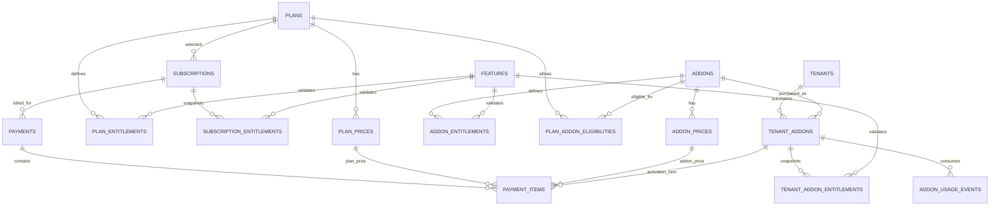

# Product Requirements Document (PRD)

## KIYU Backend API — Plan, Add-on, Feature Release, dan Feature Access Engine

**Dokumen:** PRD-KIYU-BE-BILLING-001  
**Versi:** 1.0  
**Tanggal:** 25 November 2026  
**Status:** Disetujui untuk dasar implementasi  
**Cakupan:** Backend API Laravel — tidak mencakup implementasi UI frontend pada fase ini  
**Repository acuan:** `slvinnm/kiyu-api`, branch `main`  
**Snapshot yang diperiksa:** `feacb817921c4ad8f2ce2b0129ad62573fe37212`

---

## 1. Ringkasan Eksekutif

KIYU akan menggunakan empat paket utama: **Trial, Essential, Growth, dan Enterprise**. Pelanggan memperoleh fitur bawaan sesuai paket, lalu dapat membeli add-on untuk membuka kemampuan tambahan tanpa harus meng-upgrade seluruh paket. Setiap jenis laporan mempunyai entitlement individual; entitlement agregat `basic_reports` dan `advanced_reports` tidak lagi menjadi dasar kontrol akses.

Backend harus menyediakan satu **Feature Access Engine** sebagai sumber keputusan terpusat untuk semua konteks aplikasi. Engine menggabungkan pemeriksaan:

1. status rilis global sebuah fitur (`is_feature_released`),
2. status tenant dan subscription,
3. entitlement dari plan dan add-on aktif,
4. batas kapasitas atau kuota pemakaian,
5. konteks aplikasi, tenant, fasilitas, perangkat, dan actor,
6. authorization/RBAC yang sudah berlaku.

`is_feature_released` adalah saklar ketersediaan implementasi global, bukan entitlement pelanggan. Default database dan seed awal adalah `true`, sesuai keputusan produk. Fitur yang belum selesai harus secara eksplisit disetel `false` sebelum API fitur tersebut diekspos ke pelanggan.

PRD ini mempertahankan fondasi billing yang sudah tersedia di repo—`plans`, `plan_prices`, `plan_entitlements`, `subscriptions`, `payments`, webhook, dan `EnsurePlanFeature`—lalu memperluasnya. Implementasi tidak boleh membangun sistem billing kedua atau memindahkan keputusan akses ke frontend.

## 2. Tujuan Produk dan Backend

### 2.1 Tujuan

- Menstandarkan katalog plan menjadi Trial, Essential, Growth, Enterprise.
- Memungkinkan satu tenant membeli satu atau beberapa add-on yang diizinkan untuk plan-nya.
- Mengizinkan entitlement laporan Tier 3 dibeli oleh pelanggan Essential atau Growth secara individual.
- Memisahkan entitlement produk dari status implementasi/rilis fitur.
- Menjamin satu engine memvalidasi akses fitur, kapasitas, dan kuota melalui seluruh konteks backend.
- Menjaga tenant isolation, RBAC, facility scope, dan device credential tetap menjadi lapisan keamanan terpisah.
- Mempertahankan riwayat harga, transaksi, plan, dan hak fitur yang telah dibeli.
- Menghindari pelanggan kehilangan plan lama hanya karena checkout upgrade belum dibayar.

### 2.2 Bukan tujuan fase ini

- Lifetime Plan atau pembayaran satu kali seumur hidup.
- Custom Report Builder.
- Implementasi halaman, sidebar, pricing cards, atau komponen frontend.
- Mengganti sistem RBAC/role dan facility assignment.
- Mengganti payment gateway tanpa kebutuhan terverifikasi.
- Menjanjikan SLA analytics sebelum definisi SLA dan datanya tersedia.
- Menyediakan unlimited capacity atau unlimited WhatsApp messages.

## 3. Repo Baseline dan Gap Analysis

Pemeriksaan dilakukan terhadap source code, migration, seeder, route, model, service, dan feature tests di snapshot yang tercantum pada metadata dokumen. Ini merupakan inspeksi repository, bukan pemeriksaan live database atau eksekusi test suite.

### 3.1 Komponen yang sudah tersedia

| Area | Implementasi saat ini | Catatan |
|---|---|---|
| Plan catalog | `plans` + `Plan` | Tersedia `code`, `name`, `description`, `is_active` |
| Harga plan | `plan_prices` + `PlanPrice` | Bulanan/tahunan, currency, provider, harga aktif/nonaktif |
| Entitlement plan | `plan_entitlements` + `PlanEntitlement` | `feature_code` dan JSON `value`; hanya plan source |
| Subscription | `subscriptions` + `Subscription` | Status TRIALING, ACTIVE, PAST_DUE, CANCELLED, EXPIRED |
| Payment | `payments` + `PaymentService` | Webhook diverifikasi dan mempunyai mekanisme idempotensi |
| Billing API | `SubscriptionController`, `PaymentController` | Menyediakan subscription, plans, entitlements, dan charge |
| Platform plan admin | `Platform\PlanController` | Mengelola plan, price, dan plan entitlement |
| Feature gate | `EnsurePlanFeature` | Saat ini membaca entitlement plan melalui `SubscriptionService` |
| Device capacity | `SubscriptionService` | Limit kiosk/display dan reserve slot dalam transaksi |
| Reports | `ReportController`, `ReportService`, `ExportService` | Summary, CSV, XLSX, PDF; export memakai `advanced_reports` |
| Audit | `audit_logs` | Tersedia untuk pencatatan perubahan platform/tenant |

### 3.2 Kondisi katalog saat ini

Seeder saat ini mendefinisikan:

- `TRIAL` — 14 hari, Queue Management, satu fasilitas, lima staff, satu kiosk, satu display.
- `STANDARD` — satu fasilitas, sepuluh staff, dua kiosk, dua display; Queue Management, Basic Reports, WhatsApp.
- `MULTI_FACILITY` — lima fasilitas, 50 staff, sepuluh kiosk, sepuluh display; Queue Management, Basic Reports, Advanced Reports, WhatsApp.

Belum ada Tier 3/Enterprise. Add-on catalog, add-on eligibility, add-on purchase, add-on usage ledger, dan report-specific entitlements belum tersedia.

### 3.3 Temuan yang harus diperbaiki

1. **Trial dapat diminta melalui request.** `SubscriptionController::store()` menerima `trial_days`, dan service dapat membuat subscription Trialing pada plan aktif yang dipilih. Trial harus diputuskan server-side dan hanya untuk plan Trial.
2. **Pergantian plan berisiko memutus akses sebelum pembayaran berhasil.** `SubscriptionService::start()` membatalkan subscription efektif sebelumnya sebelum pembayaran plan baru selesai. Subscription lama harus tetap efektif sampai pembayaran plan baru diverifikasi.
3. **PAST_DUE tidak boleh dianggap akses efektif.** `effectiveSubscription()` saat ini menggunakan status reservasi subscription yang lebih luas dari status yang benar-benar memberikan akses. Pemilihan current subscription dan evaluasi akses harus dipisahkan.
4. **`is_current` bukan bukti plan aktif.** `SubscriptionController::plans()` membandingkan ID subscription terbaru tanpa memastikan status dan periodenya benar-benar memberikan akses.
5. **Plan entitlement bersifat mutable.** `PlanController::updateEntitlements()` mengganti entitlement katalog secara langsung; subscription lama membaca plan entitlement terbaru. Perlu snapshot hak fitur pada saat subscription dibuat/diaktifkan.
6. **Feature gate hanya memahami plan.** Belum ada sumber hak akses add-on atau global release gate.
7. **Laporan terlalu sedikit untuk katalog yang direncanakan.** Saat ini tersedia summary dan export, bukan semua report module dalam matriks produk.
8. **Waiting time saat ini tidak mewakili waktu tunggu antrean.** Query summary menghitung `queue_sessions.created_at` ke `checked_in_at`; laporan Waiting Time harus memakai waktu tiket dibuat sampai pemanggilan pertama (`called_at` atau event pertama yang valid).
9. **Payment belum memiliki rincian item produk.** `payments` terkait subscription dan menyimpan total pembayaran, tetapi belum ada payment line items untuk add-on.
10. **WhatsApp saat ini adalah toggle tanpa quota ledger.** Paket baru memerlukan kuota pengiriman yang dapat dihitung dan diaudit.

### 3.4 Prinsip perubahan repo

- Pertahankan tabel dan model billing yang telah ada selama masih sesuai.
- Perluas domain model secara bertahap melalui migration baru.
- Jangan menghapus histori subscription/payment atau mengganti primary key plan.
- Rename kode plan dilakukan dengan migration yang aman, bukan membuat duplikat plan baru.
- Tambahkan regression tests untuk alur lama sebelum mengubah perilakunya.

## 4. Terminologi dan Keputusan Produk

| Istilah | Definisi |
|---|---|
| Plan | Paket utama tenant pada satu periode billing |
| Entitlement | Hak penggunaan fitur atau batas yang diberikan oleh plan/add-on |
| Add-on | Produk tambahan yang dapat dibeli dan memberikan satu atau beberapa entitlement |
| Feature release | Keadaan implementasi fitur yang dikendalikan secara global oleh platform |
| `is_feature_released` | Boolean global; `true` berarti implementasi diizinkan tersedia, `false` berarti dinonaktifkan secara global |
| Effective entitlement | Hasil gabungan entitlement plan snapshot dan add-on aktif |
| Feature Access Engine | Komponen backend terpusat yang menghasilkan keputusan akses fitur/kapasitas/kuota |
| Tenant | Organisasi pelanggan KIYU |
| Facility | Lokasi/fasilitas milik tenant |
| Billing period | Periode bulanan atau tahunan yang menjadi acuan plan dan add-on |

### 4.1 Kode plan yang berlaku

| Kode final | Nama tampilan | Kode lama |
|---|---|---|
| `TRIAL` | Trial | `TRIAL` |
| `ESSENTIAL` | Essential | `STANDARD` |
| `GROWTH` | Growth | `MULTI_FACILITY` |
| `ENTERPRISE` | Enterprise | Baru |

Kode lama `STANDARD` dan `MULTI_FACILITY` harus dimigrasikan menjadi `ESSENTIAL` dan `GROWTH`. Foreign key subscription tetap menunjuk `plan_id` yang sama, sehingga histori tidak kehilangan relasi. API dan seeder baru hanya menggunakan kode final. Jika dibutuhkan masa transisi, alias lama hanya boleh ditangani pada lapisan kompatibilitas sementara dan harus mempunyai tanggal penghapusan.

### 4.2 Prinsip pemisahan kontrol

Akses ke sebuah fitur hanya dapat diberikan ketika semua lapisan yang relevan lolos:

- implementasi fitur dirilis;
- tenant aktif dan mempunyai subscription yang memberikan akses;
- entitlement diberikan oleh plan atau add-on aktif;
- actor mempunyai role/permission dan facility scope yang sesuai;
- konteks aplikasi dan device credential valid;
- kapasitas/kuota masih tersedia bila fitur mengonsumsi resource.

Feature release tidak memberikan hak kepada pelanggan. Entitlement tidak melewati RBAC. Role admin tidak boleh mengubah hasil release gate untuk penggunaan fitur tenant.

## 5. Katalog Plan

### 5.1 Matriks entitlement bawaan

`✓` berarti entitlement termasuk dalam plan. `—` berarti tidak termasuk, tetapi mungkin dapat dibeli sebagai add-on jika plan eligible.

| Fitur / Report | Trial | Essential | Growth | Enterprise |
|---|:---:|:---:|:---:|:---:|
| Queue Management | ✓ | ✓ | ✓ | ✓ |
| Queue Overview | ✓ | ✓ | ✓ | ✓ |
| Daily Queue | ✓ | ✓ | ✓ | ✓ |
| Visit Details | ✓ | ✓ | ✓ | ✓ |
| Department Performance | ✓ | ✓ | ✓ | ✓ |
| Waiting Time | ✓ | ✓ | ✓ | ✓ |
| Service Duration | — | — | ✓ | ✓ |
| Queue Trends | — | — | ✓ | ✓ |
| Peak Hours | — | — | ✓ | ✓ |
| Cancellation & No-show | — | — | ✓ | ✓ |
| Staff Performance | — | — | — | ✓ |
| Facility Comparison | — | — | — | ✓ |
| Report Export (CSV/XLSX/PDF) | — | — | ✓ | ✓ |
| WhatsApp Notifications | — | — | — | — |

Trial mengadopsi kemampuan laporan inti Essential selama 14 hari. Trial tidak dapat membeli add-on. WhatsApp tidak menjadi fitur bawaan plan; pelanggan paket berbayar membelinya melalui add-on kuota.

### 5.2 Matriks kapasitas awal

| Limit | Trial | Essential | Growth | Enterprise |
|---|---:|---:|---:|---:|
| `max_facilities` | 1 | 1 | 5 | 20 |
| `max_staff` | 5 | 10 | 50 | 200 |
| `max_kiosk_devices` | 1 | 2 | 10 | 30 |
| `max_display_devices` | 1 | 2 | 10 | 30 |

Angka Trial, Essential, dan Growth mempertahankan angka yang sekarang telah ada di `BillingSeeder`. Angka Enterprise merupakan rekomendasi awal dan wajib divalidasi terhadap kapasitas infrastruktur, biaya support, dan proyeksi penggunaan sebelum harga/paket dipublikasikan. Tidak ada entitlement unlimited.

### 5.3 Aturan paket

- Trial berlangsung 14 hari, diberikan satu kali per tenant, dan tidak memiliki harga berbayar.
- Trial dibuat oleh proses signup/provisioning backend; client tidak boleh menentukan durasinya.
- Tenant tidak dapat memulai Trial kedua setelah riwayat Trial sebelumnya tercatat, kecuali platform admin melakukan grant khusus dengan audit log dan alasan.
- Essential, Growth, dan Enterprise mendukung harga bulanan dan tahunan.
- Harga dan currency disimpan sebagai data katalog; nilai harga final belum ditetapkan oleh PRD ini.
- Tenant yang beralih plan tidak boleh kehilangan plan efektif sebelum pembayaran/penerapan perubahan plan baru berhasil.
- Perubahan plan, entitlement, dan harga katalog tidak boleh mengubah snapshot hak atau harga transaksi yang sudah dibeli.

## 6. Entitlement Catalog

### 6.1 Kode entitlement final

#### Fitur operasional dan laporan

| Feature code | Jenis | Keterangan |
|---|---|---|
| `queue_management` | Boolean | Akses operasional manajemen antrean |
| `report_queue_overview` | Boolean | Ringkasan antrean dan status |
| `report_daily_queue` | Boolean | Statistik antrean berdasarkan hari |
| `report_visit_details` | Boolean | Daftar/detail kunjungan |
| `report_department_performance` | Boolean | Kinerja per departemen |
| `report_waiting_time` | Boolean | Waktu tunggu sampai dipanggil |
| `report_service_duration` | Boolean | Durasi pelayanan |
| `report_queue_trends` | Boolean | Tren volume antrean |
| `report_peak_hours` | Boolean | Distribusi antrean berdasarkan jam/hari |
| `report_cancellation_no_show` | Boolean | Pembatalan, skip, dan no-show |
| `report_staff_performance` | Boolean | Kinerja pelayanan per staff |
| `report_facility_comparison` | Boolean | Perbandingan antar-fasilitas |
| `report_export` | Boolean | Export report CSV, XLSX, dan PDF |
| `whatsapp_notifications` | Boolean | Mengirim notifikasi WhatsApp |

#### Kapasitas dan penggunaan

| Feature code | Jenis | Aturan penggabungan |
|---|---|---|
| `max_facilities` | Additive capacity | Limit plan + kapasitas add-on aktif |
| `max_staff` | Additive capacity | Limit plan + kapasitas add-on aktif |
| `max_kiosk_devices` | Additive capacity | Limit plan + kapasitas add-on aktif |
| `max_display_devices` | Additive capacity | Limit plan + kapasitas add-on aktif |
| `whatsapp_messages_per_period` | Period quota | Kuota grant aktif dikurangi konsumsi pada periode yang sama |

Kode di atas adalah kontrak backend. Penambahan report module baru memerlukan kode feature, implementasi endpoint/service, catalog registration, release state, dan tests. Database tidak boleh membuat feature code yang tidak dikenal oleh backend.

### 6.2 Penghapusan entitlement agregat

`basic_reports` dan `advanced_reports` tidak lagi menjadi entitlement otoritatif. Keduanya harus dimigrasikan ke daftar report-specific entitlement sesuai pemetaan plan lama. Setelah seluruh route, test, seeder, service, dan API consumer backend diperbarui, kode agregat lama dihapus.

Tidak boleh ada fallback permanen yang menganggap `advanced_reports` berarti semua report. Hal itu akan menghilangkan kemampuan menjual report satu per satu.

### 6.3 Dependensi fitur

- Semua report mengasumsikan data antrean yang berasal dari `queue_management` tersedia. Bila tenant tidak mempunyai `queue_management`, report tidak dapat digunakan.
- `report_export` adalah hak export terpisah. Memiliki entitlement report tidak otomatis memberikan export.
- `whatsapp_messages_per_period` harus tersedia bersama `whatsapp_notifications` dan add-on yang valid.
- `report_facility_comparison` memerlukan data dari minimal dua fasilitas yang dapat diakses tenant. Entitlement laporan tidak menaikkan `max_facilities`.
- Feature entitlement tidak pernah memberi hak mengakses tenant/facility/user lain.

## 7. Add-on Catalog

### 7.1 Kategori add-on

| Kategori | Contoh produk | Hak yang diberikan |
|---|---|---|
| Individual Reports | Service Duration, Queue Trends, Peak Hours, Cancellation & No-show, Staff Performance, Facility Comparison | Satu report entitlement per produk |
| Export | Report Export | `report_export` |
| WhatsApp | Paket kuota pesan | `whatsapp_notifications` + `whatsapp_messages_per_period` |
| Capacity | Additional Facility, Staff Pack, Kiosk Pack, Display Pack | Penambahan limit resource tertentu |

### 7.2 Eligibility awal

| Add-on | Trial | Essential | Growth | Enterprise |
|---|:---:|:---:|:---:|:---:|
| Individual report yang belum termasuk | Tidak | Ya | Ya | Tidak perlu jika sudah termasuk |
| Report Export | Tidak | Ya | Tidak perlu | Tidak perlu |
| WhatsApp quota | Tidak | Ya | Ya | Ya |
| Additional Facility | Tidak | Ya | Ya | Ya |
| Staff Pack | Tidak | Ya | Ya | Ya |
| Kiosk Pack | Tidak | Ya | Ya | Ya |
| Display Pack | Tidak | Ya | Ya | Ya |

Ketersediaan add-on harus dikelola melalui `plan_addon_eligibilities`, bukan hardcoded pada controller. Jika plan telah memiliki entitlement add-on tersebut, sistem tidak boleh menjual entitlement yang sama sebagai duplikat kecuali produk secara eksplisit didefinisikan sebagai quantity/usage pack.

### 7.3 Contoh kode produk

Kode di bawah adalah contoh katalog awal yang dapat dimasukkan oleh platform admin:

- `ADDON_REPORT_SERVICE_DURATION`
- `ADDON_REPORT_QUEUE_TRENDS`
- `ADDON_REPORT_PEAK_HOURS`
- `ADDON_REPORT_CANCELLATION_NO_SHOW`
- `ADDON_REPORT_STAFF_PERFORMANCE`
- `ADDON_REPORT_FACILITY_COMPARISON`
- `ADDON_REPORT_EXPORT`
- `ADDON_WHATSAPP_1000` — angka kuota per periode harus menjadi konfigurasi produk, bukan konstanta di service.
- `ADDON_FACILITY_1`
- `ADDON_STAFF_10`
- `ADDON_KIOSK_1`
- `ADDON_DISPLAY_1`

Harga dan kuota final add-on belum ditetapkan. Jumlah add-on kapasitas dikalikan `quantity`; misalnya dua unit `ADDON_FACILITY_1` menambah dua fasilitas.

### 7.4 Aturan pembelian dan masa berlaku

- Add-on mengikuti billing interval subscription utama (bulanan atau tahunan).
- Trial tidak eligible membeli add-on.
- Add-on aktif hanya jika pembayaran terkait terverifikasi dan subscription utama memberikan akses.
- Add-on tidak memiliki periode billing terpisah pada fase awal.
- Pembatalan berlaku di akhir periode; akses tetap aktif sampai `ends_at`.
- Saat subscription utama berakhir, add-on tidak memperpanjang akses secara mandiri.
- Saat upgrade plan memasukkan fitur yang sebelumnya dibeli sebagai add-on, add-on tersebut tidak diperpanjang lagi pada periode berikutnya dan histori tetap disimpan.
- Jika entitlement kapasitas add-on berakhir dan penggunaan tenant melebihi limit baru, data/perangkat yang sudah ada tidak dihapus otomatis. Sistem menolak pembuatan resource baru sampai penggunaan kembali sesuai limit.
- Add-on yang belum dirilis (`is_feature_released = false`) tidak boleh dibeli meskipun eligibility plan mengizinkannya.

### 7.5 Export sebagai hak terpisah

Pembelian individual report tidak otomatis mencakup export. Pengguna yang hanya membeli `report_staff_performance` dapat melihat laporan itu melalui API yang disediakan, tetapi export tetap ditolak kecuali mempunyai `report_export` dari plan atau add-on. Kebijakan ini menjaga produk tetap modular dan mudah dipahami.

## 8. Feature Release Registry (`is_feature_released`)

### 8.1 Tujuan

Feature release registry memungkinkan platform mematikan fitur secara global bila kode sudah ter-deploy tetapi implementasi belum selesai, belum siap secara operasional, atau perlu dihentikan sementara karena masalah kritis.

### 8.2 Aturan nilai

- Kolom harus bernama tepat `is_feature_released`.
- Tipe: boolean, `NOT NULL`, default `true`.
- Semua feature code yang dikenal backend harus diregistrasikan.
- Seeder awal membuat seluruh feature code terdaftar dengan `is_feature_released = true`.
- Feature yang sedang dikembangkan dan belum siap wajib disetel `false` secara eksplisit sebelum route/worker terkait diekspos ke pelanggan.
- `false` menolak penggunaan fitur di semua tenant dan semua konteks aplikasi yang mengonsumsi fitur itu.
- `false` tidak menghapus entitlement plan atau add-on, transaksi, data, atau histori pelanggan.
- Saat diubah kembali menjadi `true`, entitlement yang masih valid dapat dipakai lagi tanpa pembelian ulang.
- Perubahan status release hanya dapat dilakukan platform admin yang mempunyai permission pengelolaan feature catalog, dengan audit log.
- Tenant admin, facility admin, operator, staff, client, kiosk, display, dan public visitor tidak dapat mengubah release state.

### 8.3 Model registri fitur

Buat tabel `features` sebagai registry rilis global. Kolom minimal:

| Kolom | Keterangan |
|---|---|
| `id` | Primary key |
| `code` | Unique feature code, sama persis dengan backend enum/registry |
| `name` | Nama untuk administrasi |
| `description` | Deskripsi fungsi |
| `category` | Core, report, export, notification, capacity |
| `value_type` | BOOLEAN, CAPACITY, atau QUOTA; harus cocok dengan definisi backend |
| `is_feature_released` | Boolean, default true |
| `release_note` | Alasan/perubahan release, nullable |
| `released_at` | Waktu fitur dirilis, nullable ketika belum pernah dirilis |
| `created_at`, `updated_at` | Timestamp |

Backend enum/registry tetap menjadi allowlist kode dan sumber aturan tipe/merge. Database registry menyimpan metadata operasional dan release switch; database tidak boleh membuat kode yang tidak didukung implementasi.

### 8.4 Fail-closed behavior

- Feature code dikenal backend tetapi tidak ditemukan di tabel `features`: tolak akses (fail closed), log error konfigurasi, dan beri alert operasional. Default true tidak berarti row yang hilang otomatis dianggap true.
- Feature code tidak dikenal backend: perlakukan sebagai kesalahan konfigurasi/programming error, bukan akses bebas.
- Row ada tetapi `is_feature_released = false`: tolak akses, walaupun plan/add-on memberikan entitlement.
- Database/cache registry tidak dapat dibaca: fail closed untuk route yang membutuhkan feature gate; jangan memberikan akses berdasarkan asumsi default.

### 8.5 Pengaruh pada katalog

- Plan/add-on catalog tenant tidak boleh menawarkan pembelian feature yang belum dirilis.
- Existing entitlement disimpan. API boleh mengembalikan `is_feature_released: false` dan `available: false` secara ringkas pada entitlement yang relevan.
- Katalog tenant tidak harus membocorkan feature internal yang tidak relevan atau belum diumumkan.
- Platform admin dapat melihat seluruh feature registry, termasuk fitur unreleased.

## 9. Feature Access Engine

### 9.1 Keputusan arsitektur

Bangun satu domain service terpusat bernama `FeatureAccessEngine` (nama class final dapat mengikuti konvensi repo) dan jangan menaruh logika feature release, subscription, add-on, atau quota secara terpisah di controller.

Engine menggunakan komponen internal berikut:

1. **FeatureRegistry** — mengenali feature code, tipe, kategori, dan `is_feature_released`.
2. **EntitlementResolver** — menggabungkan snapshot entitlement subscription dan add-on aktif.
3. **SubscriptionAccessResolver** — memvalidasi status subscription, masa berlaku, status tenant, dan periode billing.
4. **UsageLimitResolver** — menghitung penggunaan, batas resource, serta kuota periodik.
5. **FeatureAccessDecision** — hasil keputusan standar beserta reason code dan informasi entitlement sumber.

`EnsurePlanFeature` yang sekarang ada diubah menjadi adapter middleware `EnsureFeatureAccess` atau tetap menjadi nama kompatibilitas sementara, tetapi seluruh keputusan harus didelegasikan ke engine. Controller tidak boleh memanggil query entitlement secara mandiri.

### 9.2 Pipeline keputusan akses

Urutan validasi request yang dilindungi feature:

1. Authenticate actor atau validasi public/device credential.
2. Resolve application context yang sesuai.
3. Resolve tenant dan facility dari trusted request context, bukan dari klaim bebas pada payload.
4. Validasi status tenant dan batas tenant/facility/device.
5. Jalankan RBAC/permission dan facility assignment yang berlaku.
6. Validasi feature code terdaftar.
7. Validasi `is_feature_released = true`.
8. Validasi dependency feature (contohnya report membutuhkan queue management).
9. Validasi subscription dan periode efektif.
10. Resolusi entitlement plan snapshot + add-on snapshot.
11. Validasi entitlement toggle/limit/quota.
12. Untuk operasi create/reserve, kunci tenant row dan cek kapasitas di dalam transaksi sebelum insert/consume.
13. Izinkan operasi dan catat usage/audit yang diperlukan.

Urutan RBAC dan feature check dapat disesuaikan untuk menghindari kebocoran informasi, tetapi tidak boleh menghilangkan satu pun pemeriksaan. Engine tidak menggantikan `EnsureApplicationContext`, `EnsureUserRole`, `ResolveTenant`, `ResolveFacility`, device credential, atau tenant-scoped query.

### 9.3 Kontrak service yang diharapkan

Engine minimal menyediakan operasi konseptual:

- `canAccess(tenant, feature, context): FeatureAccessDecision`
- `assertAccess(tenant, feature, context): void`
- `resolveEntitlements(tenant, context): EffectiveEntitlementSet`
- `resolveLimit(tenant, feature, context): ResolvedLimit`
- `assertCapacity(tenant, feature, quantity, context): void`
- `consumeQuota(tenant, feature, quantity, idempotencyKey, context): UsageResult`

Ini adalah kontrak domain, bukan kewajiban nama method literal. Semua entry point harus memakai service yang sama.

### 9.4 Format keputusan

`FeatureAccessDecision` sekurangnya membawa:

- `allowed` (boolean)
- `feature_code`
- `reason_code`
- `is_feature_released`
- `is_entitled`
- `entitlement_source` (plan, add-on, atau gabungan)
- `limit`, `used`, `remaining` jika relevan
- `context` ringkas yang tidak membocorkan secret

Reason code minimum:

- `FEATURE_UNKNOWN`
- `FEATURE_NOT_REGISTERED`
- `FEATURE_NOT_RELEASED`
- `TENANT_INACTIVE`
- `SUBSCRIPTION_REQUIRED`
- `SUBSCRIPTION_EXPIRED`
- `SUBSCRIPTION_PAST_DUE`
- `ENTITLEMENT_REQUIRED`
- `FEATURE_DEPENDENCY_MISSING`
- `ADDON_NOT_ELIGIBLE`
- `ADDON_INACTIVE`
- `CAPACITY_EXCEEDED`
- `QUOTA_EXCEEDED`
- `CONTEXT_NOT_ALLOWED`

### 9.5 Merge strategy entitlement

| Jenis entitlement | Strategi |
|---|---|
| Boolean feature | OR/union dari semua grant yang valid |
| Capacity | Plan snapshot + semua additive capacity grants aktif |
| Period quota | Jumlah grant kuota aktif untuk periode yang sama, dikurangi usage periode itu |
| Feature release | AND: harus `true`; tidak dapat diberikan oleh plan atau add-on |
| RBAC/facility authorization | AND: tetap diperiksa oleh authorization layer |

Jangan menerapkan penjumlahan generik ke semua entitlement. Strategi penggabungan harus didefinisikan per jenis feature di backend registry dan divalidasi saat katalog plan/add-on disimpan.

### 9.6 Seluruh konteks backend yang wajib memakai engine

| Konteks | Cara penerapan |
|---|---|
| Tenant Workspace | Middleware route + service-level guard untuk operasi penting |
| Tenant Admin Portal | Middleware yang sama; tidak boleh memiliki logika billing/feature duplikat |
| Public tenant endpoints | Resolve tenant melalui slug/domain yang dipercaya, lalu periksa feature yang diperlukan |
| Kiosk | Validasi device credential, tenant, facility, queue entitlement, release state, dan device scope |
| Display | Validasi device credential, tenant, facility/department, queue entitlement, dan release state |
| Public tracking | Terapkan kebijakan akses baca yang konsisten untuk session yang sudah ada; jangan membocorkan data tenant lain |
| Webhook | Signature verification dan idempotency tetap wajib; webhook tidak boleh mengaktifkan entitlement fitur unreleased |
| Queue/notification jobs | Service/job harus resolve tenant dan memeriksa entitlement/release sebelum menjalankan pekerjaan yang berbiaya atau memberi akses fitur |
| Scheduled commands | Untuk setiap tenant yang diproses, gunakan service engine; command tidak boleh menganggap seluruh tenant memiliki fitur |
| WebSocket/broadcast channels | Channel authorization dan tenant/facility scope tetap wajib; channel yang khusus fitur harus memeriksa entitlement |
| Platform Portal | Platform admin dapat mengelola registry release melalui permission khusus; akses ke data tenant tetap mengikuti support-access/audit policy |

Billing catalog, checkout, payment status, dan halaman administrasi platform harus tetap dapat diakses ketika fitur tenant tertentu belum dirilis; API tersebut adalah control plane, bukan penggunaan fitur yang dijual.

### 9.7 Cache dan invalidasi

- Cache feature registry dan entitlement resolver diperbolehkan untuk performa.
- Cache key harus mencakup kode feature, tenant ID, subscription/version identity, dan context yang relevan.
- Perubahan `is_feature_released` harus menginvalidasi cache global terkait seketika atau melalui versioned cache key.
- Perubahan subscription, payment activation, add-on activation/cancellation, entitlement snapshot, tenant suspension, dan quota usage harus menginvalidasi cache tenant terkait.
- Jangan memakai cache yang dapat mempertahankan akses setelah feature dinonaktifkan atau subscription berakhir.
- Jika invalidasi tidak dapat dijamin, TTL harus sangat pendek dan operasi sensitif wajib membaca ulang sumber data di dalam transaksi.

## 10. Desain Database Target

### 10.1 Tabel yang dipertahankan

- `plans`
- `plan_prices`
- `plan_entitlements`
- `subscriptions`
- `payments`
- `billing_webhook_events`
- `audit_logs`

### 10.2 Tabel baru

| Tabel | Kolom utama | Tujuan |
|---|---|---|
| `features` | `code`, `name`, `category`, `value_type`, `is_feature_released`, `release_note`, `released_at` | Registry feature dan release gate global |
| `subscription_entitlements` | `subscription_id`, `feature_code`, `value`, `created_at` | Snapshot entitlement plan pada subscription |
| `addons` | `code`, `name`, `category`, `description`, `is_active`, `sort_order` | Katalog add-on |
| `addon_prices` | `addon_id`, `billing_interval`, `amount`, `currency`, `provider`, `is_active` | Harga add-on per billing interval |
| `addon_entitlements` | `addon_id`, `feature_code`, `value` | Hak yang diberikan produk add-on |
| `plan_addon_eligibilities` | `plan_id`, `addon_id` | Plan yang boleh membeli add-on |
| `tenant_addons` | `tenant_id`, `addon_id`, `addon_price_id`, `status`, `quantity`, `starts_at`, `ends_at`, `current_period_start`, `current_period_end`, `cancel_at_period_end` | Pembelian/kontrak add-on milik tenant |
| `tenant_addon_entitlements` | `tenant_addon_id`, `feature_code`, `value` | Snapshot hak add-on saat dibeli/diaktifkan |
| `payment_items` | `payment_id`, `plan_price_id`, `addon_price_id`, `tenant_addon_id`, `name_snapshot`, `unit_amount`, `quantity`, `total_amount`, `currency` | Rincian item pembayaran dan snapshot harga |
| `addon_usage_events` | `tenant_addon_id`, `feature_code`, `quantity`, `idempotency_key`, `period_start`, `period_end`, `occurred_at`, `metadata` | Ledger konsumsi kuota add-on |

### 10.3 Relasi utama



### 10.4 Integrity rules

- `features.code`, `plans.code`, dan `addons.code` unique.
- Unique `(subscription_id, feature_code)` pada `subscription_entitlements`.
- Unique `(addon_id, feature_code)` pada `addon_entitlements`.
- Unique `(tenant_addon_id, feature_code)` pada `tenant_addon_entitlements`.
- Unique `(plan_id, addon_id)` pada `plan_addon_eligibilities`.
- `payment_items` wajib mereferensikan tepat satu jenis price (`plan_price_id` XOR `addon_price_id`). Validasi di service dan database check constraint bila engine database mendukung.
- `addon_usage_events.idempotency_key` unique untuk mencegah webhook/job retry menggandakan konsumsi.
- FK entitlement mengacu pada `features.code` yang terdaftar.
- Tenant addon wajib memiliki `tenant_id`; semua query harus tenant-scoped.
- Harga pada payment item merupakan snapshot; tidak boleh berubah ketika katalog diperbarui.
- Jangan cascade-delete payment, payment item, subscription, atau histori add-on yang telah dibayar.

### 10.5 Mengapa entitlement di-snapshot

`plan_entitlements` dan `addon_entitlements` adalah konfigurasi katalog untuk pembelian berikutnya. Pada saat subscription/add-on aktif, salin grant yang dibeli ke tabel snapshot masing-masing. Engine membaca snapshot subscription dan tenant add-on, bukan konfigurasi katalog mutable secara langsung.

Konsekuensinya:

- Mengedit katalog plan tidak otomatis mengubah hak subscriber lama.
- Mengubah entitlement add-on tidak mengubah hak add-on yang sudah dibeli.
- Perubahan hak pelanggan memerlukan perubahan subscription/add-on yang eksplisit, tercatat, dan dapat diaudit.
- Feature release tetap bisa memblokir penggunaan secara global tanpa mengubah snapshot pembelian.

### 10.6 Subscription pending saat upgrade

Tambahkan status `PENDING_PAYMENT` atau mekanisme checkout draft yang setara. Pending subscription tidak memberikan akses dan tidak menggantikan subscription aktif. Ketika payment webhook terverifikasi:

1. Lock tenant row.
2. Verifikasi payment, amount, currency, provider reference, dan target subscription.
3. Tandai payment paid secara idempotent.
4. Aktivasi subscription baru dan buat snapshot entitlement.
5. Hentikan subscription lama pada waktu perpindahan yang ditetapkan.
6. Sesuaikan masa berlaku/billing anchor add-on sesuai aturan transisi.

Jika pembayaran gagal/kedaluwarsa, subscription lama tetap aktif. Tenant tidak boleh mempunyai dua subscription yang sama-sama memberikan akses pada periode yang sama.

### 10.7 Pilihan tenant_addons

Add-on adalah kontrak/produk milik tenant, bukan salinan plan. `tenant_addons` terpisah dari `subscription_id` agar histori add-on tetap dapat dilacak saat tenant berpindah dari satu subscription ke subscription lain. Masa aktif dan billing period tetap mengikuti subscription utama. Sistem harus menyelaraskan `current_period_start`/`current_period_end` ketika subscription berganti atau diperpanjang.

## 11. Billing dan Payment Flow

### 11.1 Pembelian plan

1. Tenant meminta paket dan interval billing.
2. Backend validasi plan aktif dan harga aktif.
3. Backend membuat checkout/pending subscription tanpa membatalkan plan aktif.
4. Backend menghitung jumlah invoice dari line item yang valid.
5. Payment gateway membuat charge.
6. Backend menyimpan `payments` dan `payment_items`.
7. Webhook memverifikasi signature, idempotency, amount, currency, order, dan target payment.
8. Setelah PAID, subscription diaktifkan dan `subscription_entitlements` disnapshot.
9. Jika gagal, subscription lama tetap menjadi sumber akses.

### 11.2 Pembelian add-on

1. Backend mengambil subscription efektif tenant dari server, bukan dari `subscription_id` bebas pada request.
2. Validasi plan berbayar dan eligibility produk.
3. Validasi bahwa fitur add-on dirilis dan belum diberikan oleh plan/active add-on, kecuali produk quota/capacity yang memang bisa memiliki quantity.
4. Hitung harga berdasarkan `addon_prices`, billing interval plan, dan quantity.
5. Buat pending purchase/payment item.
6. Setelah webhook PAID, buat/aktifkan `tenant_addons` dan snapshot `tenant_addon_entitlements`.
7. Invalidasi cache entitlement tenant.

### 11.3 Renewals

- Interval MONTHLY/YEARLY tetap menjadi kontrak periode billing.
- Add-on yang aktif diperhitungkan pada invoice periode plan berikutnya.
- Otomatisasi auto-charge hanya boleh diaktifkan bila gateway benar-benar mendukung dan backend telah mengimplementasikan recurring token/authorization yang sah.
- Jangan mengklaim auto-renew hanya karena `billing_interval` tersedia. Jika gateway tidak mendukung recurring, sediakan renewal checkout yang dimulai tenant sebelum jatuh tempo.
- Jika tidak ada pembayaran renewal, subscription berakhir sesuai tanggal period; add-on juga kehilangan akses pada batas yang sama.

### 11.4 Cancel dan downgrade

- Cancel at period end tidak memutus akses sebelum akhir periode.
- Downgrade sebaiknya dijadwalkan pada period berikutnya agar limit/resource dan add-on tidak berubah di tengah periode tanpa konfirmasi.
- Jika limit turun di periode baru dan pemakaian melebihi batas, data tidak dihapus; pembuatan resource baru ditolak sampai penggunaan sesuai.
- Bila add-on tidak lagi eligible pada plan baru, add-on dibatalkan atau tidak diperpanjang sesuai tanggal efektif perubahan plan.

## 12. Report Modules dan Data Requirements

### 12.1 Definisi report

| Report | Data utama | Definisi/aturan |
|---|---|---|
| Queue Overview | `queue_sessions`, `queue_tickets` | Volume sesi/tiket dan distribusi status dalam periode |
| Daily Queue | `created_at`, status, facility | Agregasi harian mengikuti timezone tenant |
| Visit Details | `queue_sessions`, customer, department | Daftar kunjungan tenant/facility yang authorized; sensitive customer fields dibatasi |
| Department Performance | `department_id`, queue ticket status | Volume dan completion per departemen |
| Waiting Time | Ticket created timestamp, `called_at` / first Called event | Selisih pembuatan tiket sampai pertama kali dipanggil; exclude data tanpa panggilan dari average, laporkan count terpisah |
| Service Duration | `started_at`, `completed_at` | Selisih mulai pelayanan hingga selesai, dihitung per ticket; aturan transfer harus jelas |
| Queue Trends | session/ticket timestamps | Tren harian/mingguan/bulanan dengan batas tanggal yang valid |
| Peak Hours | timestamps + tenant timezone | Distribusi antrean berdasarkan jam lokal tenant |
| Cancellation & No-show | status + queue events | Jumlah dan rate berdasarkan denominator yang didefinisikan konsisten; cancelled, skipped, dan no-show dilaporkan terpisah |
| Staff Performance | event actor, `assigned_to_user_id`, ticket transitions | Atribusi menggunakan pelaku penyelesaian yang tercatat; assignment saja bukan bukti staff menyelesaikan |
| Facility Comparison | facility-scoped metrics | Membandingkan fasilitas dalam tenant yang sama; minimal dua fasilitas berdata |
| Export | report payload yang sama | Export CSV/XLSX/PDF sesuai report yang dapat diakses; wajib `report_export` |

### 12.2 Definisi timestamp dan kualitas data

- Waiting Time harus menggunakan timestamp tiket dibuat menuju pemanggilan pertama. Jangan memakai `queue_sessions.created_at` menuju `checked_in_at` sebagai waiting time antrean.
- Service Duration memakai `started_at` ke `completed_at` untuk ticket yang mempunyai kedua timestamp dan selesai secara valid.
- Queue Trends dan Peak Hours menggunakan timezone tenant/facility yang ditetapkan, bukan timezone server.
- Staff Performance harus menggunakan event/actor yang konsisten. Jika saat ini event completion tidak menyimpan user pelaksana secara akurat, perbaiki event attribution sebelum laporan dijual.
- Cancellation, skipped, no-show, dan completed harus dihitung sebagai kategori terpisah. Formula rate harus terdokumentasi dan tidak boleh berubah diam-diam.
- Facility Comparison menghormati tenant boundary dan facility assignment actor; data lintas tenant tidak pernah digabung.
- Report API harus membatasi date range dan pagination/streaming untuk mencegah query terlalu berat.

### 12.3 Report Builder

Custom Report Builder tidak termasuk scope dan tidak boleh ditambahkan sebagai entitlement atau add-on dalam implementasi ini.

## 13. Backend API Requirements

Nama route final dapat mengikuti route naming repo saat implementasi, tetapi perilaku berikut wajib tersedia.

### 13.1 Tenant billing API

| Method | Endpoint konseptual | Fungsi |
|---|---|---|
| GET | `/billing/subscription` | Subscription aktif/pending ringkas dan periode |
| GET | `/billing/entitlements` | Effective entitlements, release availability, usage, remaining |
| GET | `/billing/plans` | Katalog plan, harga aktif, entitlement yang sudah dirilis, current status |
| GET | `/billing/addons` | Add-on eligible untuk plan efektif tenant |
| POST | `/billing/checkout` | Membuat checkout plan + optional add-ons atau perubahan plan |
| POST | `/billing/addons` | Membeli add-on pada subscription efektif |
| POST | `/billing/addons/{id}/cancel` | Menjadwalkan pembatalan add-on pada akhir periode |
| GET | `/billing/payments` | Riwayat pembayaran tenant |
| GET | `/billing/payments/{id}` | Detail payment dan line items tenant sendiri |

Semua endpoint billing tenant hanya boleh menampilkan data tenant yang ter-resolve dari auth/context. Request body tidak boleh menentukan tenant_id atau memaksakan entitlement.

### 13.2 Platform API

| Method | Endpoint konseptual | Fungsi |
|---|---|---|
| GET | `/platform/features` | List seluruh feature registry dan release state |
| PATCH | `/platform/features/{code}/release` | Mengubah `is_feature_released` dengan audit trail |
| GET/POST | `/platform/addons` | List/create katalog add-on |
| GET/PUT | `/platform/addons/{id}` | Detail/update metadata katalog |
| POST | `/platform/addons/{id}/prices` | Membuat price version baru; jangan mutasi harga transaksi lama |
| PUT | `/platform/addons/{id}/entitlements` | Mengubah grant katalog untuk pembelian selanjutnya |
| PUT | `/platform/plans/{id}/entitlements` | Mengubah entitlement katalog untuk subscriber baru |
| PUT | `/platform/plans/{id}/addon-eligibilities` | Mengelola add-on yang eligible untuk plan |

Akses platform feature release dan katalog harus dibatasi permission platform admin khusus dan dicatat di audit log.

### 13.3 Entitlement response

API entitlement tenant sebaiknya menyediakan objek per feature, bukan hanya boolean/angka tanpa metadata. Contoh konseptual:

```json
{
  "data": {
    "report_staff_performance": {
      "released": true,
      "available": true,
      "entitled": true,
      "sources": ["addon"],
      "type": "boolean"
    },
    "max_facilities": {
      "released": true,
      "available": true,
      "limit": 3,
      "used": 1,
      "remaining": 2,
      "sources": ["plan", "addon"],
      "type": "capacity"
    }
  }
}
```

Response boleh disesuaikan dengan konvensi API saat ini, tetapi harus membedakan `released`, `entitled`, dan `available`. `available` tidak boleh true jika satu saja persyaratan penting gagal.

### 13.4 Error contract

Pertahankan format error API repo dan tambahkan error_type yang stabil:

| Kondisi | HTTP | Error type |
|---|---:|---|
| Feature unreleased | 404 atau 403 konsisten | `FEATURE_NOT_AVAILABLE` |
| Feature tidak dimiliki | 403 | `ENTITLEMENT_REQUIRED` |
| Subscription expired | 403 | `SUBSCRIPTION_INACTIVE` |
| Kapasitas penuh | 409 | `CAPACITY_EXCEEDED` |
| Quota habis | 429 atau 409 sesuai kontrak endpoint | `QUOTA_EXCEEDED` |
| Add-on tidak eligible | 422 | `ADDON_NOT_ELIGIBLE` |
| Checkout pending/invalid state | 409 | `INVALID_BILLING_STATE` |
| Kode feature tidak terdaftar | 500 internal + logged config error | Tidak diekspos secara rinci |

## 14. Security, Tenant Isolation, dan Audit

- Tenant ditentukan oleh middleware/context/domain resolver yang dipercaya, bukan payload bebas.
- Setiap query plan subscription, add-on, payment, usage, dan report untuk tenant selalu dibatasi `tenant_id`.
- Add-on entitlement tidak memberikan role, permission, facility assignment, atau cross-tenant access.
- Kiosk/display wajib memiliki credential valid, belum revoked/expired, dan terikat tenant/facility yang benar.
- Feature release global diperiksa juga oleh job/service; tidak cukup hanya menyembunyikan menu atau meng-gate route tertentu.
- Webhook memverifikasi signature, amount, currency, provider order reference, payment status transition, serta idempotency.
- Webhook replay tidak boleh mengaktifkan add-on atau subscription dua kali.
- Perubahan release state, plan entitlement catalog, add-on entitlement catalog, price, eligibility, grant/revoke, cancel, dan payment transition penting dicatat ke `audit_logs`.
- Jangan log token pairing, credential, payment secret, atau data pribadi berlebihan.
- Jangan mengandalkan browser fingerprint atau metadata device sebagai authentication.
- Jika release state berubah menjadi false, semua request/job berikutnya harus gagal meskipun cache lama sebelumnya memberi akses.

## 15. Migration dan Backward Compatibility

### 15.1 Rename plan

- Update row plan `STANDARD` menjadi `ESSENTIAL` dan `MULTI_FACILITY` menjadi `GROWTH` dengan menjaga primary key.
- Jika target code sudah ada, migration harus berhenti dengan pesan konflik yang jelas atau menjalankan merge terencana; jangan menimbulkan duplikasi.
- Update `BillingSeeder`, tests, documentation, validation, API fixtures, dan hardcoded plan references.
- `TRIAL` tetap; buat `ENTERPRISE`.

### 15.2 Map entitlement lama ke report-specific entitlement

- `basic_reports` -> `report_queue_overview`, `report_daily_queue`, `report_visit_details`, `report_department_performance`, `report_waiting_time`.
- `advanced_reports` -> `report_service_duration`, `report_queue_trends`, `report_peak_hours`, `report_cancellation_no_show`, `report_export`.
- `MULTI_FACILITY`/GROWTH baru juga menerima semua entitlement Essential.
- Enterprise menambahkan `report_staff_performance` dan `report_facility_comparison`.
- Trial baru menerima report Essential selama masa Trial.
- Hapus entitlement agregat lama setelah data dan semua consumers dimigrasikan.

### 15.3 WhatsApp grandfathering

Seeder sekarang memberikan `whatsapp_notifications` pada Standard dan Multi Facility. Perubahan katalog baru mengalihkannya menjadi add-on kuota. Pelanggan yang sudah berlangganan pada saat migrasi tidak boleh tiba-tiba kehilangan akses berbayar. Kebijakan migrasi yang direkomendasikan:

- Snapshot entitlement WhatsApp lama ke subscription lama.
- Berikan quota grandfather sementara dengan nilai yang ditetapkan platform sebelum migration dijalankan, atau lakukan komunikasi dan konversi ke add-on sebelum renewal.
- Jangan mengarang kuota default tanpa keputusan harga/biaya operasional.
- Pelanggan baru mengikuti katalog add-on WhatsApp.

### 15.4 Snapshot existing subscriptions

Backfill `subscription_entitlements` dari `plan_entitlements` untuk setiap subscription lama sesuai mapping yang disepakati. Snapshot harus mempertahankan maksud entitlement paket pada saat transisi. Jika subscription telah expired/cancelled, simpan snapshot sebagai histori tetapi jangan memberikan akses.

### 15.5 Feature registry

- Buat semua feature code final di enum/registry backend.
- Seed row `features` dengan `is_feature_released = true` secara default.
- Migrasikan route/service ke code individual.
- Jangan menganggap row hilang = released.

## 16. Non-functional Requirements

### Performance

- Resolver menghindari query N+1 dengan eager loading/bulk resolving.
- Cache release registry dan resolved entitlements dengan invalidation yang eksplisit.
- Capacity checks dan quota consumption harus atomic untuk operasi concurrent.
- Report queries harus mempunyai index sesuai tenant/facility/date dan menggunakan chunk/streaming untuk export besar.

### Reliability

- Payment webhook idempotent.
- Pending checkout tidak mengganti subscription yang aktif.
- Data billing dan payment tidak cascade deleted.
- Cache failure atau feature registry lookup failure harus fail closed pada protected feature route.
- Release flag false berlaku segera untuk akses berikutnya.

### Maintainability

- Feature code didaftarkan di satu backend registry/enum.
- Controller tidak mendefinisikan entitlement logic sendiri.
- Setiap feature mempunyai definisi type, merge strategy, dependencies, release status, dan test coverage.
- Seeder idempotent dan tidak meninggalkan entitlement lama yang seharusnya sudah dipensiunkan.

### Observability

- Log reason code untuk denial yang penting tanpa data rahasia.
- Metric untuk access denied per reason, quota exhaustion, failed payment, webhook replay, feature release changes, dan add-on activation.
- Audit log untuk perubahan admin.

## 17. Acceptance Criteria

### Feature release

- [ ] Feature registry memiliki `is_feature_released NOT NULL DEFAULT true`.
- [ ] Semua feature enum/code backend mempunyai row registry setelah seeding.
- [ ] Ketika `is_feature_released = false`, request ditolak dari Tenant Workspace, Tenant Portal, public tenant context, kiosk, display, job, dan service internal yang relevan.
- [ ] Ketika feature tidak dirilis, entitlement plan/add-on tetap tersimpan tetapi tidak dapat dipakai.
- [ ] Mengubah release menjadi true mengaktifkan kembali akses bagi entitlement yang masih valid.
- [ ] Pengubahan release hanya dapat dilakukan platform admin berizin dan tercatat audit.
- [ ] Unknown/missing feature registry gagal tertutup dan menghasilkan diagnostic log.

### Plan dan entitlement

- [ ] Plan code final adalah TRIAL, ESSENTIAL, GROWTH, ENTERPRISE.
- [ ] Database existing mengubah STANDARD -> ESSENTIAL dan MULTI_FACILITY -> GROWTH tanpa mengubah relasi histori.
- [ ] Trial 14 hari dibuat server-side dan tidak dapat dimanipulasi melalui `trial_days` request.
- [ ] Trial tidak dapat dibeli add-on dan tidak dapat diulang oleh tenant yang sama tanpa grant khusus.
- [ ] Setiap report mempunyai entitlement individual.
- [ ] `basic_reports` dan `advanced_reports` tidak lagi menjadi gate runtime.
- [ ] Plan catalog mutation tidak mengubah snapshot subscription lama.

### Add-on dan payment

- [ ] Add-on catalog dan harga dapat dikelola platform admin.
- [ ] Eligibility dikonfigurasi per plan.
- [ ] Add-on aktivasi hanya sesudah payment terverifikasi.
- [ ] Payment menyimpan line items dengan nama, unit price, quantity, currency, dan total snapshot.
- [ ] Add-on mengikuti periode plan dan berakhir ketika subscription utama tidak efektif.
- [ ] Add-on yang tidak lagi dibutuhkan setelah upgrade tidak diperpanjang, tetapi histori tetap ada.
- [ ] Additive capacity dan quota usage menerapkan strategi merge yang benar.
- [ ] Webhook retry tidak menggandakan entitlement atau quota consumption.

### Subscription lifecycle

- [ ] Plan baru berstatus pending tidak menggantikan plan lama sebelum payment sukses.
- [ ] Payment failed/expired tidak menghilangkan akses subscription lama.
- [ ] PAST_DUE tidak dianggap akses efektif kecuali kebijakan grace period eksplisit diimplementasikan.
- [ ] Current plan API hanya menandai subscription yang benar-benar efektif sebagai current.
- [ ] Expiry/cancel/renewal memperbarui akses dan cache dengan benar.

### Security dan context

- [ ] Feature engine dipakai oleh middleware dan service layer.
- [ ] RBAC, context, facility scope, tenant isolation, dan device authentication tetap enforced.
- [ ] Add-on tidak dapat melewati role/permission/facility scope.
- [ ] Tenant A tidak dapat membaca payment, entitlement, add-on, atau report Tenant B.
- [ ] Semua billing mutation tenant dibatasi tenant yang sedang ter-resolve.

### Reports

- [ ] Report endpoint hanya diakses bila entitlement report spesifik tersedia dan dirilis.
- [ ] Export memerlukan `report_export` terpisah.
- [ ] Waiting Time menggunakan waktu pembuatan tiket sampai panggilan pertama.
- [ ] Report menghormati timezone tenant dan facility scope.
- [ ] Staff attribution dan transfer semantics teruji sebelum Staff Performance dianggap siap dijual.
- [ ] Facility Comparison tidak melintasi tenant dan memerlukan minimal dua facility berdata.

## 18. Test Plan Minimum

1. Feature release false pada setiap app context (workspace, portal, public, kiosk, display).
2. Feature release false meskipun plan dan add-on sama-sama memberikan entitlement.
3. Feature release true namun tenant tidak punya entitlement.
4. Feature row hilang dan feature code unknown (fail closed).
5. Plan entitlement dan add-on entitlement union.
6. Additive capacity dari plan + beberapa add-on.
7. Concurrent resource creation pada slot kapasitas terakhir.
8. WhatsApp quota: success, exhaustion, retry idempotency, period reset.
9. Add-on purchase: pending, paid, failed, expired, cancelled, duplicate webhook.
10. Plan upgrade: active old plan + pending new plan; payment success; payment failure.
11. Plan downgrade pada period boundary; penggunaan melebihi limit baru.
12. Trial: satu kali, 14 hari, request tampering, expired trial.
13. Plan catalog edit tidak mengubah snapshot subscriber lama.
14. Add-on catalog edit tidak mengubah snapshot purchaser lama.
15. Tenant isolation semua endpoint billing/add-on/report.
16. RBAC tetap menolak actor tanpa permission meskipun plan/add-on memberi feature.
17. Kiosk/display credential revoked, expired, dan cross-facility.
18. Report metrics dan timezone boundary tests.

## 19. Tahapan Implementasi Backend

### Phase 0 — Safety dan baseline

- Tambahkan regression tests untuk behavior billing yang sekarang.
- Perbaiki current subscription resolution, `is_current`, dan trial request tampering.
- Pastikan payment pending tidak menonaktifkan subscription lama.

### Phase 1 — Registry dan Feature Access Engine

- Tambahkan `features` registry dan `is_feature_released`.
- Perluas backend Feature enum/definition.
- Implementasikan registry resolver, entitlement resolver, decision object, engine, middleware adapter, dan integration hooks.
- Tambahkan audit log dan cache invalidation.

### Phase 2 — Plan catalog dan snapshot

- Rename plan codes.
- Tambahkan Enterprise.
- Tambahkan report-specific entitlement.
- Tambahkan `subscription_entitlements` dan backfill.
- Update seeder dan platform plan admin.

### Phase 3 — Add-on catalog dan billing

- Tambahkan tabel add-on, eligibility, tenant purchase, snapshot grants, payment items, dan usage events.
- Implementasikan checkout line items dan verified webhook activation.
- Implementasikan cancel/expiry/renewal behavior.

### Phase 4 — Reports

- Split route gate per report entitlement.
- Implementasikan report module yang belum tersedia.
- Perbaiki waiting time dan staff attribution.
- Pastikan export gate terpisah.

### Phase 5 — Hardening dan API contract

- Selesaikan feature access tests across contexts.
- Uji race conditions, webhook idempotency, tenant isolation, cache invalidation, and data migration.
- Perbarui `docs/API_CONTRACT.md`, `docs/DATABASE_DESIGN.md`, dan dokumentasi arsitektur.
- Siapkan API response contract untuk frontend sebagai pekerjaan fase berikutnya.

## 20. Risiko dan Keputusan yang Belum Ditentukan

PRD ini menetapkan bentuk produk dan kontrak backend, tetapi nilai komersial yang belum diberikan tidak boleh diisi dengan angka rekaan.

| Keputusan | Status |
|---|---|
| Harga bulanan/tahunan setiap plan | Belum ditentukan |
| Harga masing-masing report add-on | Belum ditentukan |
| Harga dan kuota WhatsApp per pack | Belum ditentukan; harus berdasarkan biaya provider |
| Harga capacity packs | Belum ditentukan |
| Validasi angka kapasitas Enterprise | Perlu uji beban dan proyeksi infrastruktur |
| Grace period untuk pembayaran terlambat | Default awal: tidak ada grace access; dapat dikonfigurasi kemudian |
| Gateway recurring/auto-charge | Belum dianggap tersedia sampai diverifikasi end-to-end |
| Nilai WhatsApp grandfathering customer lama | Harus ditentukan sebelum migrasi, jangan diasumsikan |
| Proration upgrade di tengah periode | Fase awal: perubahan terjadwal atau checkout dengan aturan eksplisit; jangan menghitung proration tanpa policy |
| Retensi historis report/export | Mengikuti kebijakan storage dan compliance; bukan hak export permanen tanpa batas |

## 21. Definition of Done

Backend dinyatakan memenuhi PRD ketika:

1. Empat plan final dapat dikonfigurasi dan disediakan oleh API.
2. Report entitlements bersifat individual.
3. Add-on dapat dibeli, dibayar, diaktifkan, dibatalkan, dan kedaluwarsa dengan benar.
4. `is_feature_released` dapat memblokir fitur secara global di semua konteks backend.
5. Semua feature decision berasal dari Feature Access Engine yang sama.
6. Snapshot menjaga hak pembelian lama dari perubahan katalog.
7. Payment lifecycle tidak merusak subscription aktif saat checkout gagal.
8. Tenant isolation, RBAC, facility scope, device authentication, dan webhook verification tetap berjalan.
9. Acceptance criteria dan test plan minimum lulus.
10. Dokumentasi API, database, dan arsitektur diperbarui.

---

## Appendix A — Repo references reviewed

Repository: `https://github.com/slvinnm/kiyu-api`  
Branch: `main`  
Inspected snapshot: `feacb817921c4ad8f2ce2b0129ad62573fe37212`

- `app/Enums/Feature.php`
- `database/seeders/BillingSeeder.php`
- `database/migrations/2026_10_28_060000_create_kiyu_domain_schema.php`
- `app/Services/SubscriptionService.php`
- `app/Http/Controllers/Api/Billing/SubscriptionController.php`
- `app/Services/PaymentService.php`
- `app/Http/Controllers/Api/Platform/PlanController.php`
- `app/Http/Middleware/EnsurePlanFeature.php`
- `app/Http/Controllers/Api/ReportController.php`
- `app/Services/ReportService.php`
- `routes/api.php`
- `docs/DATABASE_DESIGN.md`
- `docs/API_CONTRACT.md`

**Inspection limitation:** no production database query, local test execution, or frontend repository audit was performed as part of preparing this PRD. Implementation must verify current deployed data and run migrations/tests in a controlled environment before release.
