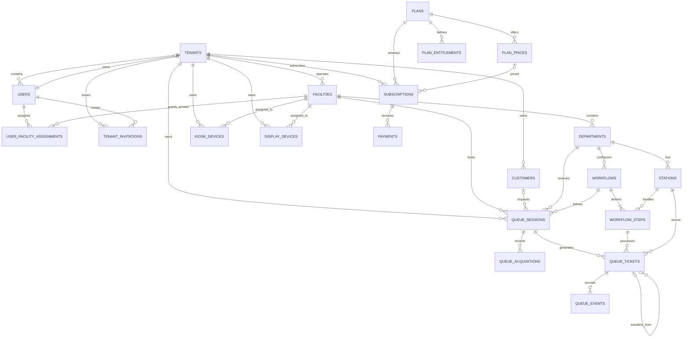

# KIYU - Product Requirements Document (PRD)
## SaaS Architecture, Domain Generalization, RBAC, Database Refactoring, and Migration

**Document version:** 1.0  
**Status:** Approved architecture baseline with implementation decision gates  
**Audience:** Coding agents, backend engineers, frontend engineers, database engineers, QA  
**Product:** KIYU - General-Purpose Queue Management SaaS  
**Date:** 24 November 2026

---

## 0. Instruction to the Coding Agent

This PRD is the primary product and architecture brief for the KIYU codebase refactoring. Use it together with the actual repository, migrations, tests, API contracts, and the supplied database dump.

**Do not start by rewriting code.** First inspect the repository and produce an evidence-based audit that maps the implementation to this PRD. The supplied SQL dump is a structural snapshot; it explicitly does not include exported table data. It is not proof of the current production data state.

The architecture and product decisions explicitly marked **Approved** are the target baseline. The sections marked **Decision Gate** are not approved for unilateral implementation. You may investigate them and recommend a solution, but you must ask the product owner and wait for explicit approval before making the affected schema, role, permission, workflow, or product-policy change.

You are allowed to discover missing requirements and propose new roles, tables, columns, endpoints, permissions, workflows, or architecture decisions. You are **not** allowed to silently introduce them. Every proposal must include:

1. The observed problem and code/database evidence.
2. Why the change is necessary.
3. At least two viable options where practical.
4. Your recommendation and rationale.
5. Impacts on database, backend, frontend, API compatibility, existing data, security, and tests.
6. Migration and rollback implications.
7. A direct approval question.

Do not ask again about decisions already marked Approved. Do not delete data, drop tables, remove production columns, change account/role semantics, or introduce new roles without the required approval.

## 1. Executive Summary

KIYU is a **general-purpose, multi-tenant queue management SaaS**. It must not be designed, named, documented, or implemented as a clinic, hospital, patient-management, or medical workflow product.

The refactoring must establish clear boundaries between:

- **Platform:** KIYU itself, its plans, tenants, platform administration, and SaaS operations.
- **Tenant / Organization:** the customer organization that purchases KIYU and owns one subscription context.
- **Facility:** a physical or operational location belonging to a tenant. One tenant may own multiple facilities.
- **Department:** a service unit within a facility.
- **Workflow:** the sequence of service steps used to process a queue session.
- **Service point / station:** the counter or operational point assigned to a workflow step.
- **Queue operations:** customers, queue sessions, queue acquisitions, tickets, events, counters, and transfers.
- **Devices:** kiosk and display devices registered to a tenant and assigned to a facility.

The agreed business model is:

- One globally unique email address maps to one user account.
- One tenant owner account owns exactly one organization / tenant.
- An organization can have multiple user accounts.
- One organization can have multiple facilities.
- A user's role is global within that tenant; a user cannot have a different role at each facility.
- Facility access is controlled through user-to-facility assignments.
- Device quotas are counted across the entire tenant, not independently per facility.
- A facility does not receive its own tenant or subdomain.
- Kiosk and display devices use device credentials and their registered facility assignment to resolve their operational context.

The main goal is not a cosmetic rename. It is to make the database, backend, frontend, authentication, authorization, subscription enforcement, and queue lifecycle consistently represent this model.

## 2. Product Vision and Objectives

### 2.1 Product vision

Provide a configurable queue management platform usable by organizations in different industries and countries. The core product manages people requesting services, service departments, queue workflows, service points, queue tickets, displays, kiosks, and operational reporting without requiring industry-specific concepts.

### 2.2 Objectives

1. Establish reliable platform-versus-tenant identity boundaries.
2. Support one organization per tenant owner account and multiple facilities per organization.
3. Implement the agreed six-role model and facility-based access assignments.
4. Enforce tenant and facility data isolation at application and database levels.
5. Generalize clinic-specific data and terminology into queue-management concepts.
6. Preserve the workflow-centric queue engine unless the audit proves a necessary redesign.
7. Enforce plan entitlements globally across all facilities of a tenant.
8. Support tenant public registration and invitation-based registration under explicit policies.
9. Support kiosk and display devices without facility-specific subdomains.
10. Migrate existing data safely where data preservation is required.
11. Remove dead code and obsolete clinical/medical paths after confirming that no active functionality depends on them.

### 2.3 Success criteria

The refactored application is successful when:

- A customer can register on the SaaS platform, create one organization, select a plan, pay, and access the tenant application.
- One tenant can have multiple facilities, departments, workflows, service points, kiosks, and displays.
- Device limits are enforced across the tenant, regardless of facility distribution.
- A user has one global tenant role and may be assigned to one or multiple facilities.
- A FacilityAdmin can administer only assigned facilities.
- A user from Tenant A cannot read or modify Tenant B data, even by changing identifiers in a request.
- A user assigned to Facility A cannot perform Facility B operations unless their role gives tenant-wide access.
- Queue registration, ticket lifecycle, transfers, counters, kiosk intake, display updates, and reports work without medical-domain data.
- No active application flow requires MRN, patient records, diagnosis, clinical departments, medical history, or other medical-only information.

## 3. Scope

### 3.1 In scope

- Domain and URL architecture.
- SaaS customer registration and tenant provisioning.
- Tenant user public registration and invitation flow.
- Platform and tenant authentication context.
- Six global user roles.
- Facility assignment and facility-level authorization.
- Multi-facility organization management.
- Facility/department/workflow/service-point structure.
- General customer and queue-session domain.
- Queue ticket, event, transfer, counter, and intake lifecycles.
- Kiosk and display device pairing, credentials, assignment, and plan limits.
- Subscription, plan, price, entitlement, payment, and webhook integration.
- Audit logging and tenant isolation.
- Backend API routing and policies.
- Frontend routes, navigation, forms, and domain-aware behavior.
- Database refactoring, data migration, tests, and documentation.
- Removal of medical/clinical terminology and unused dependencies.

### 3.2 Explicitly out of scope

Unless separately approved, KIYU is not an electronic medical record, hospital information system, clinic management system, pharmacy system, laboratory system, appointment/medical billing product, or patient identity platform.

Do not add:

- MRN / medical record numbers.
- Patient records or patient-specific workflows.
- Diagnosis, treatment, prescription, laboratory, pharmacy, or clinical notes.
- NIK or another national identity number as a mandatory queue field.
- Clinical roles or clinical-only workflow states.
- Medical-specific dashboard metrics.
- Facility-specific subdomains.
- One deployment or one database per facility.
- Multiple tenants owned by one owner account.
- A new independent `queues` entity unless the repository audit proves that workflow-centric modeling cannot satisfy an approved business requirement.

Sensitive or demographic customer attributes such as national identity numbers, date of birth, gender, and address must not be collected in the core queue model by default. Any future collection requires a documented, specific business purpose and product-owner approval.

## 4. Approved Architecture Decisions

The following decisions are approved and must be treated as constraints.

| Area | Approved decision |
|---|---|
| Product | General-purpose queue management SaaS; no clinical/medical domain |
| Marketing domain | `kiyu.id` |
| SaaS platform application | `app.kiyu.id` |
| Tenant application | `{tenantSlug}.kiyu.id` |
| Central API | `api.kiyu.id` |
| Platform admin | Same `app.kiyu.id` application, separate `/platform` area and authorization |
| Tenant owner | TenantAdmin and canonical owner of one tenant |
| Ownership cardinality | One owner account owns one tenant; one tenant has one canonical owner |
| Tenant membership | A tenant may have multiple user accounts |
| Facilities | One tenant may own multiple facilities |
| User role scope | One global role per user within the tenant; role does not vary by facility |
| Facility access | Many-to-many assignment for FacilityAdmin, Operator, and Staff |
| TenantAdmin access | Implicit access to all facilities in the tenant; no per-facility assignment required |
| Queue architecture | Department- and workflow-centric |
| Registration policy | Tenant supports both public registration and invitations, subject to tenant policy |
| Device context | Device credential resolves the registered tenant and facility |
| Device quota | Kiosk and display quotas are aggregated across all facilities in a tenant |
| Facility URL | No facility-specific subdomain |

### 4.1 Domain responsibilities

| Host | Responsibility |
|---|---|
| `kiyu.id` | Public marketing website, product information, pricing, documentation, and calls to action |
| `app.kiyu.id` | SaaS customer portal and platform administration in one application |
| `{tenantSlug}.kiyu.id` | Tenant application, user access, queue operations, kiosk pages, and display pages |
| `api.kiyu.id` | One central backend API serving platform, portal, tenant, public, device, and webhook contexts |

The same tenant host serves all facilities belonging to the organization. Example pages include `/dashboard`, `/kiosk`, and `/display`. The device credential and server-side device record determine the facility context. A facility does not need a hostname such as `jakarta.acme.kiyu.id`.

### 4.2 Tenant resolution

The API is hosted at `api.kiyu.id`, so the API hostname alone does not identify the frontend tenant. The backend must resolve the tenant using a validated tenant context supplied by the tenant application, such as the tenant slug in a trusted request header or equivalent explicit context.

The supplied slug is a context selector, **not an authorization credential**. For authenticated tenant users, the backend must verify that the authenticated user belongs to the resolved tenant. For kiosk/display requests, the device credential must resolve to a stored device record whose tenant and facility are then used as the authoritative context. Never trust a request-body `tenant_id` or `facility_id` as proof of access.

The exact header/path convention must be selected after inspecting the existing frontend, API client, Sanctum configuration, CORS, cookies, reverse proxy, and deployment configuration. Do not create a second convention in parallel with an existing safe implementation.

## 5. Identity, Roles, and Authorization

### 5.1 Approved roles

The target role values are:

| Role identifier | Scope | Description |
|---|---|---|
| `platform_admin` | Platform | KIYU platform administrator; not a tenant member |
| `tenant_admin` | Tenant | Organization owner and tenant-wide administrator |
| `facility_admin` | Assigned facilities | Full administrator for assigned facilities, without tenant billing or organization ownership powers |
| `operator` | Assigned facilities | Intake and queue operations |
| `staff` | Assigned facilities | Processes queue tickets at assigned facilities/service points |
| `client` | Tenant user / self-service | End user who can access only their own account/customer/queue data |

Migration mapping from the current enum:

| Current role | Target role |
|---|---|
| `PlatformAdmin` (`platform_admin`) | `platform_admin` |
| `Admin` (`admin`) | `tenant_admin` |
| `Receptionist` (`receptionist`) | `operator` |
| `Staff` (`staff`) | `staff` |
| `Client` (`client`) | `client` |
| New | `facility_admin` |

Do not create `Buyer`, `Purchaser`, `SaaSOwner`, `TenantOwner`, `BillingAdmin`, `DeviceAdmin`, `DepartmentAdmin`, or `Supervisor` roles as part of this refactor.

### 5.2 Global role rule

A user has one role stored on the user account. The role applies consistently across every facility assigned to that user. A user cannot be an Operator in one facility and a Staff member in another facility using the same account.

The facility assignment determines **where** the user can act. The global role determines **what** the user can do.

### 5.3 Canonical owner

Each tenant must have exactly one canonical `owner_user_id`. The owner must be a user belonging to that tenant and must have the `tenant_admin` role. The owner manages subscription and billing and has tenant-wide administration access.

The initial SaaS registration flow must create the tenant and its owner account as one transactional provisioning operation. Do not persist a normal tenant customer as a non-platform user with `tenant_id = NULL` unless a separate onboarding identity state is explicitly approved. Platform administrators are provisioned internally and are not created through public signup.

**Decision Gate:** Whether additional users may also receive the global `tenant_admin` role while the tenant still has one canonical owner. Recommended default: one canonical owner account is the only TenantAdmin in the initial release; additional tenant-wide admins require explicit approval.

### 5.4 Facility assignments

Create a facility assignment relation, provisionally named `user_facility_assignments`:

| Field | Purpose |
|---|---|
| `id` | Primary key |
| `tenant_id` | Tenant ownership and isolation |
| `user_id` | Assigned tenant user |
| `facility_id` | Facility the user may access |
| `assigned_by_user_id` | User who created the assignment |
| `created_at`, `updated_at` | Audit timestamps |

Required unique constraint: `(tenant_id, user_id, facility_id)`.

Expected behavior:

- `tenant_admin`: implicit access to all facilities in their tenant; no pivot rows required.
- `facility_admin`: must have one or more facility assignments.
- `operator`: must have one or more facility assignments.
- `staff`: must have one or more facility assignments.
- `client`: no facility assignment required; access is limited to own data.
- `platform_admin`: no tenant/facility assignment. Cross-tenant support must use an explicit platform support context.

The relation must use composite tenant-aware constraints where supported, so a user from Tenant A cannot be assigned to a facility belonging to Tenant B.

The ownership relationship is cyclic because the tenant points to its owner and the owner points back to the tenant. A safe implementation may create the tenant with a temporarily nullable owner reference inside a single transaction, create the user with the tenant ID, then update the tenant owner reference before commit. A composite relationship can enforce that the owner user belongs to the same tenant. The final persisted state of a provisioned tenant must have a valid owner. Do not leave ownerless active tenants.

The current `users.department_id` and `users.station_id` columns may represent more granular assignments. Audit all their uses before replacing them. If department- or service-point-level assignment is still needed, propose a separate normalized assignment model. Do not discard that behavior without approval.

### 5.5 Permission model

Use Laravel Policies and Gates for resource/action authorization. Middleware should establish authentication and context boundaries; it must not be the only protection for resource-level authorization.

| Capability | PlatformAdmin | TenantAdmin | FacilityAdmin | Operator | Staff | Client |
|---|---:|---:|---:|---:|---:|---:|
| Manage all tenants and plans | Yes | No | No | No | No | No |
| View/manage own tenant | Support context | Yes | No | No | No | No |
| Manage subscription and billing | Platform support | Yes | No | No | No | No |
| Create/delete facilities | Platform support | Yes | No | No | No | No |
| Manage assigned facility configuration | Platform support | Yes | Yes | No | No | No |
| Manage assigned facility departments/workflows/service points | Platform support | Yes | Yes | No | No | No |
| Manage devices in assigned facilities | Platform support | Yes | Yes | No | No | No |
| Manage users and facility assignments | Platform support | Yes | Limited to assigned scope, no global-role escalation | No | No | No |
| Register a service customer / acquire queue | No | Yes | Yes | Yes | As explicitly allowed | Self-service only |
| Process queue tickets | No | Yes | Yes | Limited operational actions | Yes, within assignment | No |
| View tenant-wide reports | Platform support | Yes | No | No | No | No |
| View assigned-facility reports | Platform support | Yes | Yes | Limited | Limited | No |
| Read own profile/queue | No | Yes | Yes | Yes | Yes | Yes |

Platform support actions must be auditable. PlatformAdmin must not become a tenant user or silently inherit tenant permissions merely by supplying a tenant ID. Use an explicit, validated platform-tenant support context and log the actor, target tenant, action, reason where required, and timestamp.

FacilityAdmin may administer users/assignments within assigned facilities only within a constrained permission boundary. FacilityAdmin must not grant `platform_admin` or `tenant_admin`, change another user's global role, create facilities, transfer ownership, or manage subscription/billing. If invitations are used by FacilityAdmin, invitation role choices must be restricted to approved non-privileged roles and the invited user must only receive the authorized facility assignment.

### 5.6 Role enforcement invariants

- `platform_admin` must have `tenant_id IS NULL`.
- Every tenant role must have a non-null `tenant_id`.
- Tenant owner must belong to the same tenant and have `tenant_admin`.
- FacilityAdmin, Operator, and Staff must have valid facility assignment(s).
- Client access to customer/queue records must be ownership-scoped.
- Role assignment is global, not stored on `user_facility_assignments`.
- Client input must never control role assignment.
- No public or invitation flow may grant `platform_admin`.

## 6. User Journeys and Product Workflows

### 6.1 SaaS customer purchase and organization provisioning

1. Visitor opens `kiyu.id`.
2. Visitor selects a plan or clicks Get Started.
3. Visitor is redirected to `app.kiyu.id`.
4. Visitor registers using a globally unique email address and supplies organization details, including the requested tenant slug.
5. Backend validates the slug, reserved hostnames, and email uniqueness.
6. Backend transactionally creates the tenant and the owner user, assigns the user `tenant_admin`, links `tenants.owner_user_id`, and creates any required onboarding state.
7. Customer chooses a plan/price and starts payment or an approved trial.
8. Payment provider webhook is signature-verified, deduplicated, and processed idempotently.
9. Tenant/subscription status is updated according to the approved subscription lifecycle.
10. Customer can access `app.kiyu.id` Customer Portal and `{tenantSlug}.kiyu.id` Tenant Application.

Do not activate a tenant solely because the browser returns from a payment page. The backend must use verified provider events or another approved server-side confirmation.

### 6.2 Customer Portal and Platform Administration

Both use `app.kiyu.id`, but they are separate authorization areas:

- TenantAdmin uses the Customer Portal for organization settings, facilities, users, devices, subscription, billing, and reports.
- PlatformAdmin uses `/platform` for tenant management, plans, platform-level payments/monitoring, platform users, and support tools.

A frontend route being hidden is not a security boundary. All platform endpoints must enforce PlatformAdmin server-side.

### 6.3 Tenant user registration

The tenant application is reached at `{tenantSlug}.kiyu.id`.

Two registration methods are required:

**Public registration**

- Tenant must have public registration enabled.
- Server resolves the tenant from the tenant application context.
- Server validates the tenant's registration policy and status.
- Public self-registration must not accept a caller-selected privileged role.
- Proposed safe default: public registration creates `client` accounts only.

**Invitation registration**

- A tenant user with the required permission creates an invitation.
- Invitation is scoped to one tenant and has a hashed, single-use token and expiry.
- Invited role and facility assignments must be authorized by the inviter's scope.
- Invitation must not be usable in another tenant.
- Invitation cannot grant `platform_admin`.

**Decision Gate:** Confirm the exact invitation role matrix and whether public registration can be configured to create any non-Client role. Until approved, implement only the conservative public-registration default of `client` and restrict privileged role assignment to TenantAdmin-controlled flows.

### 6.4 Organization and facility management

- One tenant can manage multiple facilities.
- A facility belongs to exactly one tenant.
- Departments belong to a facility.
- Workflows belong to a department.
- Workflow steps reference service points/stations in the same department/workflow context.
- Devices are assigned to a facility.
- Facility access is checked for FacilityAdmin, Operator, and Staff.
- TenantAdmin can switch between all facilities or view tenant-wide reporting.

### 6.5 Kiosk and display device lifecycle

1. TenantAdmin or an authorized FacilityAdmin creates a device record for a facility within subscription entitlement limits.
2. Backend issues a short-lived pairing code.
3. Device opens the tenant host's kiosk or display route.
4. Device redeems the pairing code.
5. Backend stores/returns a device credential securely; only a hash is stored server-side.
6. Device requests authenticate through the device credential.
7. Backend resolves tenant and facility from the device record, not request-body IDs.
8. Inactive, expired, revoked, or disabled devices are denied.
9. Device last-seen/health telemetry is updated safely.

Kiosk and Display are device identities, not user roles. They must not use a shared generic `client` user account.

### 6.6 Queue operation flow

1. Customer arrives or starts an online service request.
2. Intake path resolves tenant and facility.
3. Customer is selected/created as a general customer record, or the queue session is created without a registered customer when the flow permits.
4. Department and active workflow are selected.
5. Queue session is created with a tenant/facility-scoped session number and tracking token.
6. Queue acquisition records the acquisition channel/idempotency context if the current domain model requires it.
7. Queue ticket(s) are generated from the workflow steps.
8. Ticket is assigned/served by the appropriate service point and operational user.
9. Queue events record status transitions and actor information.
10. Ticket completion, cancellation, no-show, skip, hold/resume, or transfer is recorded according to the approved lifecycle.
11. Display devices show only the queues associated with their configured facility/department/service-point scope.

The workflow remains the foundation. Do not add a separate `queues` table without evidence that Department + Workflow + WorkflowStep cannot represent an approved use case.

## 7. General-Purpose Domain Model

### 7.1 Organization domain

- `Tenant`: organization subscribing to KIYU.
- `Facility`: one physical/operational location belonging to a tenant. The term is retained for consistency with the approved FacilityAdmin role and existing schema. User-facing copy may use "Location" if product design chooses, but do not create a second location entity.
- `Department`: service unit within a facility.
- `Station` / `ServicePoint`: counter or operational point serving workflow steps. Audit whether `stations` should be renamed to `service_points`; the concept must not be clinic-specific.
- `Workflow`: ordered process for a department.
- `WorkflowStep`: one step in a workflow, with sequence, optional/skip behavior, and assigned service point.

### 7.2 Customer and queue domain

- `Customer`: person requesting a service. A customer need not have a login account.
- `QueueSession`: one service/queue interaction at a facility and department, following a workflow.
- `QueueAcquisition`: retain only if it represents a distinct intake/acquisition/idempotency record in current business logic.
- `QueueTicket`: a ticket generated for a workflow step.
- `QueueEvent`: append-oriented record of ticket transitions and actors.
- `QueueCounter`: number generator scoped to a station/service point and date where required.
- `QueueSessionCounter`: number generator scoped to a facility and date where required.
- `ServiceTransfer` / `QueueTransfer`: possible generalization for existing referral/transfer behavior; not approved until current referral semantics are audited.

### 7.3 Medical/clinical terminology removal

The core product must not contain the following concepts:

- `Patient`, `Patients`, patient controller/resource terminology.
- `MRN` / medical record number.
- Diagnosis, prescription, medication, clinical note, pharmacy, laboratory, treatment, or medical history fields and workflows.
- Clinical queue controllers and clinic-specific labels.

The current SQL table is named `clients`, and it contains `mrn`, `nik`, `date_of_birth`, `gender`, phone, email, and address. The target logical entity is `Customer` / `customers`.

Remove MRN. Do not carry NIK into the general customer entity by default. Do not carry date of birth, gender, or address into the core customer record unless an evidence-based non-medical product requirement is approved. Retain only minimal fields required by current general queue workflows, expected initially to be name and optional contact details. Preserve optional account linkage only after auditing its current behavior and cardinality.

The `Client` role is distinct from the `Customer` entity:

- `Client` is an authenticated user role.
- `Customer` is an operational service-recipient record and may exist without a login.

Do not assume a one-to-one user/customer relation until existing code behavior and the product owner confirm it.

### 7.4 Existing referral behavior

The current SQL contains `referrals` with source visit, target department, optional target visit, referrer, status, priority, and reason. Do not delete this table based on its name alone.

Audit its actual use:

- If it is a clinical referral concept with no general queue use, remove its routes, code, and table through an approved data migration.
- If it represents a generic handoff/reassignment between service departments or queue sessions, propose a general entity such as `service_transfers` or `queue_transfers` and explain its lifecycle.
- If the behavior is already fully represented by ticket transfers, prove that before consolidating it.

No implementation choice is authorized until the audit report is reviewed and the product owner approves the selected option.

## 8. Target Database Requirements

This section describes the logical target. It is not a command to blindly create every listed column. The coding agent must compare it with existing migrations, models, constraints, and data, then produce a final ERD and migration mapping for approval.

### 8.1 Platform and tenant identity

**`users`**

- `id` primary key.
- `tenant_id` nullable only for PlatformAdmin.
- `name`, globally unique `email`, password/authentication fields.
- `role` from the approved six-value role set.
- Verification and timestamps.
- Remove legacy single `department_id` / `station_id` only after their assignment semantics have been migrated to an approved model.

**`tenants`**

- `id`, unique `slug`, `name`, status, timezone, billing/contact details, `allow_public_registration` (default false), optional settings, timestamps.
- Add unique `owner_user_id` referencing the canonical owner.
- Owner must belong to the same tenant and have `tenant_admin`.
- Provision owner and tenant transactionally.

Do not add an `account_type` column simply because it appeared in an earlier conceptual diagram. The supplied SQL dump's `users` table does **not** contain `account_type`; inspect the actual repository migrations and choose one source of truth. The recommended model uses the role plus tenant membership invariant unless the audit finds a justified need for a separate account-state field.

**`tenant_invitations`** (new)

- `id`, `tenant_id`, invited email, role, token hash, invited-by user, expiry, accepted/revoked timestamps, audit timestamps.
- Single-use, tenant-scoped, expiring, hashed token.
- Enforce authorized role and facility assignment during creation and acceptance.

### 8.2 Facility access

**`user_facility_assignments`** (new)

- `id`, `tenant_id`, `user_id`, `facility_id`, `assigned_by_user_id`, timestamps.
- Unique `(tenant_id, user_id, facility_id)`.
- Tenant-aware composite foreign keys or equivalent database-enforced constraints.
- No role column in this table because role is global on `users`.

### 8.3 Organization

Retain `facilities` as the organization location entity for this refactor unless the audit recommends a terminology-only rename with clear benefits and the product owner approves it.

- `facilities.tenant_id` is mandatory.
- `departments` must be verifiably owned by the same tenant as their facility.
- `stations` / service points must belong to a department in the same tenant/facility.
- Workflows belong to departments.
- Workflow steps must belong to their workflow and reference a service point within the same department/facility/tenant context.

### 8.4 Queue domain target mapping

| Current table / field | Target concept | Requirement |
|---|---|---|
| `clients` | `customers` | General-purpose customer record; remove medical identifiers |
| `clients.mrn` | Remove | No medical-record identifier in core product |
| `clients.nik` | Remove by default | No national identifier in the core queue model |
| `clients.date_of_birth` / `gender` | Remove by default | Not required for general queue operations unless separately approved |
| `visits` | `queue_sessions` | General service/queue session; preserve behavior and history |
| `visits.client_id` | `queue_sessions.customer_id` | Optional general customer linkage, subject to cardinality audit |
| `visits.facility_id` | `queue_sessions.facility_id` | Preserve facility context |
| `visits.visit_number` | `queue_sessions.session_number` | General session number; preserve facility counter scope |
| `visits.visit_token` | `queue_sessions.tracking_token` | Secure tracking token |
| `visit_counters` | `queue_session_counters` | Facility/date counter if still required |
| `stations` | Station / ServicePoint | General counter; rename only if justified and approved |
| `workflow_steps.station_id` | service-point assignment | Preserve workflow step processing behavior |
| `queue_acquisitions.visit_id` | `queue_acquisitions.queue_session_id` | Preserve idempotency and intake semantics |
| `queue_tickets.visit_id` | `queue_tickets.queue_session_id` | Ticket belongs to a queue session |
| `queue_events` | Queue history | Correct actor model and tenant integrity |
| `referrals` | Review | Remove or generalize only after audit and approval |

Renaming `visits` to `queue_sessions` and `clients` to `customers` is the recommended target terminology. Use a safe migration strategy and preserve IDs/history where possible. If a direct rename causes significant API or data compatibility risk, propose an expand-and-contract alternative.

### 8.5 Queue integrity

- A queue session must reference a facility, department, and workflow that all belong to the same tenant and compatible facility context.
- A workflow must belong to the selected department.
- Each workflow step must reference a service point in the same department/facility context as the workflow.
- A queue ticket must reference a queue session and valid workflow step/service point in the same tenant and compatible facility context.
- Ticket transfer history must remain queryable and must not allow a cross-tenant transfer.
- Queue event actor IDs must use a consistent type/reference strategy.
- Queue counters must be safe under concurrent requests, using transactions/row locks or another proven atomic strategy.
- Unique constraints must prevent duplicate session/ticket numbers within the intended scope.
- The existing facility/date session counter and station/date ticket counter semantics must be audited and preserved unless a different numbering rule is approved.

### 8.6 Device domain

Retain `kiosk_devices` and `display_devices` as separate device classes unless the code audit proves a shared device model is materially simpler without weakening security.

Each device must have:

- Tenant ownership.
- Facility assignment.
- Unique credential hash.
- Pairing-code hash and expiry where applicable.
- Paired/active/revoked/expired lifecycle as supported by existing behavior.
- Last-seen telemetry.
- No plaintext long-lived device credential persisted in the database.

Use tenant-aware composite integrity so `device.tenant_id` must match `device.facility_id` ownership.

**Decision Gate - Display targeting:** The existing SQL stores `tenant_id` and `facility_id` on display devices but no department/service-point target. The product owner described displays distributed by department. Audit current display behavior and propose one of:

1. One display targets one department.
2. One display targets one service point.
3. One display can target multiple departments/service points through a pivot/configuration model.

Explain the effect on UI, pairing, API filtering, and schema. Ask for approval before adding target columns or pivot tables.

### 8.7 SaaS billing

Retain and audit:

- `plans`
- `plan_prices`
- `plan_entitlements`
- `subscriptions`
- `payments`
- `billing_webhook_events`

Requirements:

- Subscription belongs to one tenant.
- Tenant owner manages its subscription and billing.
- PlatformAdmin manages plan catalog and platform-level billing oversight.
- Entitlements are the authoritative source of plan limits/features.
- Price history must remain reconstructable; changing a current plan price must not rewrite the historical amount/currency of an existing subscription or payment.
- Payment records and webhook processing must be idempotent.
- Payment webhook signature verification must occur before state changes.
- Financial/audit history must not be deleted through accidental cascade behavior.
- Tenant status and subscription status are separate lifecycle concepts.

### 8.8 Device and facility entitlements

Device limits are global at tenant level, not per facility.

Examples of entitlement keys:

- `max_kiosk_devices`
- `max_display_devices`
- `max_facilities` (optional plan feature; do not enforce until the product owner approves the packaging policy)

The total number of counted kiosk devices across every facility in a tenant is compared with `max_kiosk_devices`. The equivalent applies to display devices.

**Decision Gate - quota counting:** Recommended policy is that registered/active devices consume a slot even when temporarily offline; explicitly deactivated/revoked devices do not. The agent must inspect current behavior and seek approval before changing quota semantics.

Quota enforcement must be atomic under concurrent device creation/pairing attempts. Two simultaneous requests must not exceed the plan limit.

## 9. Backend API Architecture

Use one Laravel backend and organize routes by security and business context. Proposed logical groups:

```text
/api/platform/*   PlatformAdmin-only operations
/api/portal/*     SaaS customer portal and tenant owner operations
/api/tenant/*     Authenticated tenant operations
/api/public/*     Public, tenant-resolved endpoints
/api/device/*     Device-authenticated kiosk/display operations
/api/webhooks/*   Provider callbacks with signature verification
```

This is a proposed route taxonomy. The agent must compare it with current routes and avoid unnecessary endpoint breakage. Route names/prefixes may be finalized in an API migration plan, but security boundaries are mandatory.

### 9.1 Platform API

Examples:

- Platform authentication/session.
- Tenant listing and management.
- Plan and entitlement management.
- Platform-level payment/subscription oversight.
- Explicit tenant support context.
- Platform audit logs.

All endpoints require PlatformAdmin authorization. Platform accounts are not tenant accounts.

### 9.2 Customer Portal API

Examples:

- SaaS customer registration/onboarding.
- Tenant owner profile and organization settings.
- Facility management.
- User and invitation management.
- Device management and quota visibility.
- Subscription, billing, payment history.
- Tenant-wide reports.

Authorization must verify the caller is the tenant owner or has an explicitly approved tenant-wide permission. Do not assume any user with a tenant ID can manage billing.

### 9.3 Tenant API

Examples:

- Tenant login/session.
- Users and facility assignments.
- Customers.
- Departments, stations/service points, workflows, workflow steps.
- Queue sessions, acquisitions, tickets, events, transfers.
- Facility devices.
- Reports and audit logs.

Each query and mutation must be scoped to the authenticated user's tenant and, where applicable, assigned facility.

### 9.4 Public and device API

- Public queue tracking may use a high-entropy tracking token and return only minimal public data.
- Public registration must check tenant policy.
- Kiosk intake must derive tenant/facility from authenticated device credentials.
- Display data must be filtered to the device's configured target.
- Device pairing is rate-limited and single-use where appropriate.
- Public endpoints require rate limits and abuse protection.

### 9.5 Webhooks

Webhook handlers must be independent of tenant browser authentication. Provider signature validation, event deduplication, idempotent processing, and replay protection are mandatory. Resolve the subscription/tenant from verified provider references, not untrusted request parameters.

## 10. Frontend Architecture and UX Requirements

### 10.1 `kiyu.id`

Public marketing only. It must not attempt to register an end user into a tenant because no tenant context exists at the root domain.

### 10.2 `app.kiyu.id`

One SaaS application with two protected areas:

- Customer Portal: organization owner experience.
- Platform Administration: internal KIYU administration.

Suggested page families:

```text
/login
/register
/onboarding/organization
/onboarding/plan
/onboarding/payment
/dashboard
/organization
/facilities
/users
/invitations
/devices
/subscription
/billing
/platform
/platform/tenants
/platform/plans
/platform/payments
/platform/audit-logs
```

The exact URLs can follow current frontend conventions. The required separation is authorization and navigation, not necessarily separate frontend deployments.

### 10.3 `{tenantSlug}.kiyu.id`

Tenant application, with pages such as:

```text
/login
/register
/invitations/accept
/dashboard
/customers
/queues
/tickets
/departments
/stations
/workflows
/users
/devices
/reports
/kiosk
/display
```

A tenant host must resolve exactly one tenant. Reserved hostnames such as `app`, `api`, `www`, and other infrastructure labels must not be available as tenant slugs.

### 10.4 Kiosk and display UX

- Kiosk page is device-focused and does not require a normal staff login once paired.
- Display page is read-only and device-authenticated.
- Pairing/recovery flows must prevent a device from changing its assigned tenant/facility through client parameters.
- A device can be deactivated/revoked by an authorized administrator.
- Device quota use must be visible to TenantAdmin and relevant FacilityAdmin.

## 11. Global Product Requirements

KIYU is intended to be usable internationally. Do not hardcode Indonesia-specific or medical-specific assumptions into the core model.

- Use IANA timezone identifiers. Tenant timezone must be configurable; facility timezone may override/inherit from tenant according to an explicit rule.
- Do not force `Asia/Jakarta` as the global default for new tenants.
- Store timestamps consistently (recommended UTC) and render them using the tenant/facility timezone.
- Use ISO 4217 currency codes for plans and payments.
- Do not assume IDR-only pricing or integer formatting that is incompatible with other currencies.
- Use Unicode-safe text handling and internationalized validation.
- Phone numbers, if collected, should use a documented international format strategy.
- Do not require NIK, national identity numbers, or country-specific identifiers.
- Keep locale and timezone separate; language is not inferred solely from currency or location.

## 12. Security, Privacy, and Data Integrity

### 12.1 Tenant isolation

Tenant isolation must be enforced in multiple layers:

1. Context resolution.
2. Authentication membership validation.
3. Policies/Gates.
4. Tenant-scoped query patterns and model relationships.
5. Database constraints for cross-tenant relationships.
6. Integration tests attempting cross-tenant access.

Do not rely only on frontend filters or middleware route groups.

### 12.2 Facility isolation

For FacilityAdmin, Operator, and Staff, every facility-scoped query/mutation must check `user_facility_assignments`. Test direct ID substitution, nested resource access, exports, reports, and bulk operations.

### 12.3 Composite integrity

The supplied SQL uses separate foreign keys in several places where a tenant and facility/resource relationship must also match. Examples include devices, visits, queue acquisitions, departments, and related queue entities.

Add tenant-aware composite foreign keys or equivalent proven database constraints where practical. At minimum, the application must validate the full ownership chain in a transaction and test it. Prefer database-enforced constraints for high-risk relationships.

### 12.4 Actor identity and ID type consistency

The supplied SQL has `users.id` as `BIGINT UNSIGNED`, but several actor/assignment fields are `VARCHAR(255)`, including examples in audit logs, queue events, referral references, assigned-to, and registered-by fields. Inspect their semantics. If a field is a user FK, normalize it to the matching ID type. If the actor can be a device/system, design an explicit actor type/reference strategy rather than storing ambiguous string IDs.

### 12.5 Audit logging

Audit important actions:

- Platform administration.
- Tenant provisioning and ownership changes.
- Role changes and user invitations.
- Facility creation/deactivation.
- Device pairing, revocation, and assignment.
- Subscription/payment state changes.
- Platform support access to a tenant.
- Significant queue state transitions where operational history is required.

Audit logs must identify the actor, tenant context, action, target entity, timestamp, and useful metadata without storing credentials or unnecessary sensitive data.

### 12.6 Data minimization

Do not store plaintext device credentials, invitation tokens, payment secrets, or unnecessary customer identity details. Remove clinical identifiers and any medical-only fields as part of the approved generalization, after confirming backups/retention obligations.

## 13. Current Database Baseline and Known Findings

The supplied `table.sql` dump identifies MySQL 9.7.4 and reports that table data export was not selected. It includes these principal tables:

- Platform/tenant: `tenants`, `users`, `audit_logs`.
- Organization: `facilities`, `departments`, `stations`, `workflows`, `workflow_steps`.
- Customers/queue: `clients`, `visits`, `queue_acquisitions`, `queue_tickets`, `queue_events`, `referrals`, `queue_counters`, `visit_counters`.
- Devices: `kiosk_devices`, `display_devices`.
- Billing: `plans`, `plan_prices`, `plan_entitlements`, `subscriptions`, `payments`, `billing_webhook_events`.

The dump is a schema snapshot, not a full repository or production audit. Verify all items against Laravel migrations and the live target environment.

### 13.1 Specific observed schema gaps

1. `tenants` has no `owner_user_id` in the supplied SQL.
2. `users` has `tenant_id`, `role`, `department_id`, and `station_id`, but no `account_type` column in the supplied SQL. Do not assume an account_type column exists.
3. `users.email` is globally unique in the supplied SQL.
4. `clients` contains `mrn`, `nik`, `date_of_birth`, and `gender`; these must not survive as default core requirements.
5. `kiosk_devices` and `display_devices` store both `tenant_id` and `facility_id` but use separate foreign keys. A mismatched tenant/facility pair is not prevented by those two constraints alone.
6. `visits` stores tenant, facility, client, department, and workflow IDs with individual foreign keys. Cross-tenant/cross-facility compatibility needs stronger validation/constraints.
7. `queue_acquisitions` stores tenant and department context separately from visit context; verify that they always match.
8. `queue_tickets` does not store `tenant_id` in the supplied schema and relies on related records. Decide whether explicit tenant scope is needed for integrity/querying.
9. `queue_events.user_id`, `audit_logs.user_id`, `referrals.referred_by_user_id`, `queue_tickets.assigned_to`, and `queue_acquisitions.registered_by` are strings. Inspect whether these are user IDs, display labels, or polymorphic actors.
10. `queue_tickets` has `station_id` and `workflow_step_id`; ensure both belong to the same department/facility/workflow context.
11. `referrals` may represent clinical referral or a general service handoff. Its actual controller/service/frontend usage must be audited before removal or renaming.
12. `billing_webhook_events` in the supplied SQL has no `subscription_id` column, even though an earlier conceptual ERD showed a relationship. Use the real migration/schema as the source of truth.
13. `payments.subscription_id` currently cascades on subscription deletion. Financial history should not be lost through accidental cascade deletion; review the delete policy and propose a safe retention strategy.
14. `payments.amount` and `plan_prices.amount` are currently `INT`. Verify range, precision, currency, and provider conventions before changing the type.
15. `tenants.timezone` defaults to `Asia/Jakarta`. The global product must not hardcode this default for every new tenant.
16. `visit_counters` scopes sequence by facility/date, while `queue_counters` scopes by station/date. Preserve or deliberately redesign these scopes after reviewing actual numbering behavior.
17. `display_devices` currently have a facility assignment but no explicit department/service-point target in the supplied SQL.
18. The SQL dump does not show the exported application data. Row counts, orphan records, duplicate values, actual status distribution, and production data quality remain unknown.

### 13.2 Current API route observations

The route definition shared for review contains these existing architectural patterns:

- `/auth/register` is currently grouped with public authentication and uses `public-tenant` middleware. This must be reviewed because SaaS customer registration at `app.kiyu.id` must not require an existing tenant.
- The operational authenticated route group uses `auth:sanctum` and `tenant` middleware. Preserve the tenant boundary, but extend it with resource-level facility authorization.
- Platform endpoints are grouped under `/platform` with `auth:sanctum` and `platform` middleware. This is a useful existing separation to retain and harden.
- Platform support routes use a `platform-tenant` context for managing a selected tenant. Preserve explicit support context and ensure every support action is audited.
- The route file references `ClinicalQueueController`. Replace clinical-specific naming with general queue terminology after tracing all lifecycle methods and frontend consumers.
- Public intake, kiosk pairing, display pairing, queue tracking, and payment webhooks already exist as distinct concerns. Do not collapse device authentication or webhook verification into ordinary tenant-user authentication.

The agent must compare these observations with the full current route file and the actual frontend API calls. The excerpt reviewed in the design conversation may not represent every route or middleware binding in the repository.

## 14. Refactoring and Migration Strategy

Use an **Audit -> Approve -> Expand -> Migrate -> Verify -> Contract** approach.

Do not modify historical migrations that have already run in shared or production environments. Create forward migrations. If the project is confirmed to be disposable development-only data, the agent may propose a fresh baseline, but must obtain explicit approval before dropping/resetting any database.

### Phase 0 - Repository and database audit (no code changes)

Inspect:

- All Laravel migrations and current database schema.
- Eloquent models, relationships, casts, scopes, observers, factories, seeders.
- Controllers, Form Requests, services, jobs, events, listeners, notifications.
- Middleware, Gates, Policies, authentication, Sanctum, CORS, CSRF, cookies.
- All routes, API resources, serializers, validation and rate limits.
- Frontend routing, API clients, state, role checks, forms, tables, dashboards, device pages.
- Tests, fixtures, documentation, environment/configuration, deployment and subdomain routing.
- Every reference to clinical terms and identifiers.

Produce:

1. Existing schema ERD from actual migrations/database.
2. Existing route/API inventory.
3. Existing role/permission matrix.
4. Current registration/authentication flow diagram.
5. Tenant/facility/device data-flow diagram.
6. Clinical/medical dependency inventory.
7. Data migration risk report.
8. Proposed target ERD and table mapping.
9. Open decision list.

Stop and request approval before code/schema changes.

### Phase 1 - Architecture and contract finalization

- Reconcile this PRD with actual code.
- Finalize unresolved decision gates.
- Produce Architecture Decision Records (ADRs).
- Finalize target ERD, constraints, statuses, API contracts, and route migration plan.
- Confirm whether existing data must be preserved.

No implementation of an unapproved proposal.

### Phase 2 - Identity and ownership foundation

- Introduce target role values and a data migration mapping.
- Add tenant owner relationship.
- Enforce one canonical owner per tenant.
- Enforce platform-versus-tenant membership invariants.
- Implement transactional tenant/owner provisioning.
- Add facility assignment table and tenant-aware constraints.
- Implement and test Policies/Gates.
- Preserve platform support flow with audit logging.

### Phase 3 - Tenant registration and invitations

- Separate SaaS registration from tenant user registration.
- Implement owner/tenant onboarding on `app.kiyu.id`.
- Implement tenant public registration setting.
- Implement invitation creation, hashing, expiry, revocation, single-use acceptance, and tenant scoping.
- Add role/assignment authorization.
- Test tenant registration without a pre-existing tenant context and tenant-user registration with a valid tenant context.

### Phase 4 - Organization and facility authorization

- Preserve multi-facility tenant structure.
- Enforce department-to-facility ownership.
- Enforce station/service-point and workflow-step ownership.
- Add facility-scoped user access.
- Migrate old single `users.department_id` / `users.station_id` behavior to the approved assignment design.
- Add tests for users with one and multiple facility assignments.

### Phase 5 - Generalize the queue domain

- Migrate `clients` toward `customers` and remove medical-only fields after backup and approval.
- Migrate `visits` toward `queue_sessions` with mapping and data preservation.
- Update queue acquisitions, tickets, events, counters, transfers, and public tracking.
- Review and resolve referral behavior.
- Remove clinical terminology in controllers, classes, routes, resources, frontend, tests, seeders, and docs.
- Preserve workflow-centric queue behavior.

### Phase 6 - Device and entitlement refactoring

- Enforce tenant-wide aggregate kiosk/display limits across all facilities.
- Ensure facility assignment on every device.
- Preserve secure pairing and credential hashing.
- Implement approved display targeting.
- Enforce atomic quota checks and test concurrent creation attempts.
- Keep offline active devices counted according to the approved quota policy.

### Phase 7 - Billing and subscription hardening

- Verify plan/price/entitlement relationships.
- Preserve historical price and payment data.
- Make provider events idempotent and signature-verified.
- Separate tenant lifecycle from subscription lifecycle.
- Prevent unintended financial record deletion.
- Test renewal, failed payment, cancellation, expiration, and reactivation states that the product currently supports or approves.

### Phase 8 - Frontend and API integration

- Implement host/domain context resolution.
- Separate Customer Portal and Platform Administration navigation/authorization.
- Implement tenant application routes.
- Implement facility switcher for users with multiple assignments and TenantAdmin.
- Implement kiosk/display mode.
- Update API types, validators, and error handling.
- Remove clinical labels and flows.

### Phase 9 - Verification and contract cleanup

- Run all automated tests and security/regression suites.
- Verify data reconciliation and foreign keys.
- Verify no active runtime references to removed legacy tables/columns/classes.
- Remove old columns/tables only after safe cutover and approval.
- Update API documentation, architecture diagrams, setup instructions, and operator docs.

## 15. Migration Safety Requirements

- Take a verified database backup before destructive operations.
- Establish whether production data exists and must be preserved.
- Use expand-and-contract where a direct rename would break live code or external clients.
- Preserve primary keys or provide explicit old-to-new ID mapping.
- Compare source and target row counts and key relationships.
- Detect and resolve orphan records before adding constraints.
- Do not silently discard MRN/NIK or other existing customer data before confirming backup, retention, and approval requirements.
- Do not cascade-delete subscriptions, payments, audit logs, queue history, or legally/operationally important records without explicit approval and a retention design.
- Make migrations restart-safe where practical and avoid non-transactional assumptions for large data moves.
- Document deployment order and rollback limitations.
- Provide a rollback plan for each migration batch; if rollback is not safe after data transformation, state that clearly and require a forward-fix/recovery plan.

## 16. Testing and Acceptance Criteria

### 16.1 Identity and ownership

- PlatformAdmin can authenticate on the platform application and has `tenant_id = NULL`.
- PlatformAdmin cannot be created by public registration.
- Tenant owner is created with `tenant_admin` and belongs to exactly one tenant.
- Tenant owner relationship points to a user in the same tenant.
- A user email is globally unique.
- A tenant user cannot change their tenant ID or role through request payloads.
- Owner/tenant provisioning is atomic; partial records are not left behind on failure.

### 16.2 RBAC and facility assignment

- TenantAdmin can access all facilities in their tenant.
- FacilityAdmin can manage only assigned facilities.
- Operator and Staff can operate only assigned facilities and permitted queue actions.
- Client can access only their own profile and queue information.
- Global role does not differ by facility.
- A user may have more than one facility assignment.
- No user can be assigned to a facility in another tenant.
- FacilityAdmin cannot grant TenantAdmin or PlatformAdmin privileges.
- Platform support access is explicit and auditable.

### 16.3 Registration

- SaaS customer registration creates an owner and tenant without requiring a pre-existing tenant.
- Tenant registration is resolved on the tenant host.
- Public registration is rejected when disabled.
- Public registration cannot assign privileged roles.
- Invitation is tenant-bound, expires, is single-use, and cannot be replayed across tenants.
- Invitation creator cannot assign roles/locations beyond their authority.

### 16.4 Organization and queue

- Tenant can have multiple facilities.
- Departments are scoped to their facility and tenant.
- Workflows are scoped to departments.
- Workflow steps reference valid service points in the correct organization context.
- Queue session, acquisition, ticket, event, and counter relationships remain consistent.
- Ticket transitions are valid and auditable.
- Queue numbering is atomic and unique within the approved scope under concurrency.
- Ticket transfer cannot cross tenant boundaries.

### 16.5 Devices and plans

- Kiosk and display are bound to one tenant and facility.
- Device credentials are hashed at rest.
- Pairing codes expire and cannot be reused.
- Device requests derive tenant/facility from the stored device record.
- A device cannot select another facility via request payload.
- Kiosk quotas are counted across all tenant facilities.
- Display quotas are counted across all tenant facilities.
- Concurrent device registration cannot exceed quota.
- Inactive/revoked/expired device behavior matches the approved counting policy.
- Display output is filtered to the approved target scope.

### 16.6 Billing and webhooks

- Plan entitlement checks are server-side.
- Tenant A cannot read or mutate Tenant B subscription/payment data.
- Webhook signature verification happens before processing.
- Duplicate provider events do not duplicate state changes or payments.
- Historical price/amount/currency is reconstructable.
- Failed payment does not activate a tenant incorrectly.
- Financial records are not accidentally cascade-deleted.

### 16.7 General-purpose product cleanup

- No active user-facing flow refers to patient, MRN, diagnosis, treatment, prescription, clinic, hospital, or clinical department concepts.
- No medical-only fields are required to create a customer or queue session.
- No medical controller/service/route remains in the active product unless it has been deliberately generalized and approved.
- Existing queue functionality is preserved or consciously redesigned with approval.

## 17. Observability and Operational Requirements

- Log tenant and facility context for relevant operational errors without leaking secrets or sensitive customer data.
- Log device pairing, revocation, and quota-rejection events.
- Log payment webhook receipt, verification result, deduplication outcome, and processing result.
- Use correlation/request IDs across frontend, API, queue jobs, and webhook handlers where supported.
- Monitor queue counter contention and failed ticket transitions.
- Provide actionable error responses for tenant mismatch, facility access denied, entitlement limit reached, invalid pairing, and expired invitation.
- Avoid returning internal tenant/resource existence details in public endpoints where that would enable enumeration.

## 18. Required Agent Deliverables

The agent must deliver these artifacts as part of the refactor:

1. Repository architecture audit.
2. Existing database ERD and target database ERD.
3. Existing-to-target table/column mapping.
4. Role and permission matrix.
5. Tenant/facility authorization flow diagrams.
6. Domain and route architecture documentation.
7. ADRs for every approved architectural decision.
8. Migration plan with data preservation and rollback notes.
9. Implemented Laravel migrations and data migrations.
10. Refactored backend models, policies, services, middleware, controllers, and routes.
11. Refactored frontend pages, route guards, API types, and forms.
12. Tests covering tenant isolation, facility isolation, devices, billing, registration, and queue lifecycle.
13. Clinical/medical dependency removal report.
14. Final verification report with commands executed and test outcomes.
15. List of deferred items and decisions that still require product-owner approval.

## 19. Mandatory Agent Workflow and Approval Gates

### Gate 0 - Read-only audit

Inspect the entire repository and database migrations. Do not edit code or database. Report findings and gaps against this PRD.

### Gate 1 - Target design confirmation

Present the final target ERD, API route map, role/policy map, and migration strategy. Ask for approval on unresolved decision gates.

### Gate 2 - Foundational implementation

After approval, implement identity, owner relationship, roles, facility assignments, tenant context, and policies. Run focused tests before continuing.

### Gate 3 - General queue domain migration

Implement customer/queue-session generalization and remove clinical-only dependencies according to the approved mapping. Preserve data and behavior.

### Gate 4 - Devices, plans, billing, and frontend

Implement aggregate plan limits, device targeting, portal/tenant UI, and approved registration/invitation behavior.

### Gate 5 - Final validation and cleanup

Run regression/security tests, data reconciliation, and code/dependency searches. Do not drop old schema objects until all references are removed, data is verified, and the product owner has approved the contract phase.

### Agent conduct requirements

- Inspect code before proposing changes.
- Do not assume the current ERD, SQL dump, or route excerpt contains every repository feature.
- Do not rewrite working code just to match naming preferences.
- Do not add a new role, permission, table, domain, status, or workflow without approval if it changes product semantics or data ownership.
- Do not silently change global role semantics.
- Do not make FacilityAdmin a tenant-wide administrator.
- Do not treat a tenant slug or facility ID from the client as authorization.
- Do not create facility-specific subdomains.
- Do not preserve clinical concepts merely because they exist in legacy code.
- Do not delete legacy data or columns without backup, mapping, and approval.
- Keep changes small enough to review and test.
- Update API documentation and tests with every contract change.
- Report completed work with files changed, migrations added, tests run, failures, and remaining risks.

## 20. Decision Gates Still Requiring Product-Owner Confirmation

The following items are deliberately not silently decided by this PRD:

| ID | Decision | Current recommendation | Why approval is needed |
|---|---|---|---|
| DG-01 | Can a tenant have additional `tenant_admin` users besides its canonical owner? | Start with one TenantAdmin/owner | Changes global authorization and admin delegation |
| DG-02 | What roles may an invitation creator assign? | TenantAdmin can assign all approved tenant roles; FacilityAdmin limited to Operator/Staff/Client within assigned facility | Changes privilege escalation boundaries |
| DG-03 | Can public registration create only `client` accounts? | Yes, Client only | Establishes safe self-registration policy |
| DG-04 | Can one display target one department, one service point, or many? | Inspect current UI and propose one-to-many/pivot only if needed | Changes device schema and display UX |
| DG-05 | Which device states consume plan quota? | Active registered devices count, including offline; revoked/inactive do not | Changes customer billing/limit behavior |
| DG-06 | Should `max_facilities` be a plan entitlement? | Support entitlement key, but do not enforce until plan packaging is approved | Changes commercial plan design |
| DG-07 | Does Staff need department/service-point-level assignment beyond facility access? | Audit current `users.department_id` / `station_id` usage | Changes assignment schema and operational permissions |
| DG-08 | Is `referrals` a clinical-only feature or a general service handoff? | Audit; generalize only if real business behavior exists | Could remove meaningful workflow behavior or data |
| DG-09 | What is the exact customer-account to customer-record cardinality? | Preserve optional `customers.user_id` behavior pending audit | Affects identity linkage and uniqueness constraints |
| DG-10 | Should `facilities`, `stations`, and `visits` be physically renamed to `facilities`, `service_points`, and `queue_sessions`? | Prefer general queue terminology, but use safe expand/contract | Rename affects models, APIs, frontend, and migrations |
| DG-11 | Is an onboarding flow allowed to create a default facility automatically? | Do not assume; inspect current UX and ask | Affects tenant provisioning and minimum organization setup |
| DG-12 | What is the approved deletion/retention policy for queue, audit, payment, and customer data? | Preserve historical/financial records by default | Affects cascade rules, privacy, and compliance |

If a gate blocks one area, continue independent approved audit/refactoring work where safe. Do not make the blocked decision on the user's behalf.

## 21. Definition of Done

The refactor is complete only when all of the following are true:

- The implementation matches approved domain boundaries and URLs.
- The six-role model is consistently implemented in backend, frontend, and database validation.
- One canonical owner account maps to one tenant.
- A tenant can own multiple facilities.
- Facility-based access is enforced server-side and tested.
- Queue flows are general-purpose and workflow-centric.
- Medical/clinical concepts and identifiers are removed from active core product paths.
- Kiosk/display devices are securely paired and scoped to a facility.
- Device limits are aggregated at tenant level and enforced atomically according to approved policy.
- Subscription, payment, and webhook logic is tenant-safe and idempotent.
- Cross-tenant and cross-facility authorization tests pass.
- Existing data is reconciled or a clearly approved clean-slate migration is documented.
- API and frontend contracts are consistent.
- Documentation, ERD, migration notes, tests, and deployment instructions are updated.
- All unresolved decision gates are either approved or explicitly deferred.
- No destructive migration or unapproved product decision remains hidden in the implementation.

---

## Appendix A - Suggested Target Domain Relationship (Logical ERD)

The following is a logical relationship sketch, not a final SQL migration. The agent must validate optionality, cardinality, unique constraints, and exact foreign keys against the implementation audit.



## Appendix B - Suggested Route Contexts

```text
api.kiyu.id
+-- /api/platform/*    PlatformAdmin context
+-- /api/portal/*      SaaS customer / TenantAdmin context
+-- /api/tenant/*      Tenant application context
+-- /api/public/*      Public tenant-resolved endpoints
+-- /api/device/*      Kiosk and display device credentials
+-- /api/webhooks/*    Payment-provider callbacks
```

The route taxonomy may be adapted to avoid unnecessary breaking changes, but each endpoint must have one clearly documented context, authentication method, tenant-resolution method, facility scope, and authorization policy.

## Appendix C - Existing-to-Target Terminology

| Existing term | Target/general term | Notes |
|---|---|---|
| Patient / Patients | Remove | No patient domain in KIYU |
| MRN | Remove | Medical-only identifier |
| NIK | Remove from core by default | Country-specific sensitive identifier; not required for queues |
| Client record (`clients`) | Customer (`customers`) | Distinguish from the `Client` user role |
| Visit (`visits`) | Queue Session (`queue_sessions`) | General service interaction |
| Visit Counter | Queue Session Counter | Preserve facility/date number scope if still needed |
| Facility | Facility | Retain as operational location entity |
| Department | Department | Generic service department |
| Station | Station / Service Point | Generic counter/service point |
| Clinical Queue Controller | Queue Controller / Queue Operations | Remove clinical naming |
| Referral | Service/Queue Transfer, or remove | Audit semantics before decision |
| Receptionist | Operator | General intake/queue role |
| Admin | TenantAdmin | Clarify tenant-wide administration |
| PlatformAdmin | PlatformAdmin | Platform-only account |

---

**End of PRD - KIYU Refactoring v1.0**
